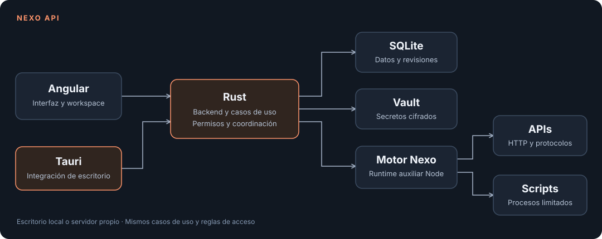

[](README.md)
[](README.es.md)

# Nexo API

**Tus APIs. Tu workspace. Tu infraestructura.**

[](LICENSE)
[](https://github.com/DaftyCode/nexo_api/actions/workflows/desktop.yml)
[](https://github.com/DaftyCode/nexo_api/releases)

Nexo API es una aplicación **100% open source**, con licencia MIT, para construir, organizar, ejecutar y probar APIs desde tu equipo.

Nos inspiramos en Postman y en la comodidad de reunir peticiones, colecciones, entornos y pruebas en un mismo lugar. A partir de esa inspiración estamos construyendo un proyecto independiente, con implementación propia y una arquitectura basada en **Tauri + Rust + Angular**.

Queremos una herramienta ágil, que arranque rápido, responda con fluidez y mantenga tus datos bajo tu control. Rust ejecuta el backend nativo y Tauri integra el WebView del sistema para el escritorio. Las peticiones, los scripts, los protocolos, los mocks y los datasets también se ejecutan en Rust, dentro del mismo proceso; los scripts usan un sandbox QuickJS embebido. Node solo hace falta para compilar la interfaz, nunca para ejecutar la aplicación. Publicaremos mediciones reproducibles de arranque, memoria y latencia a medida que avance el proyecto.

El proyecto está en fase inicial. Las contribuciones, ideas, pruebas y revisiones son bienvenidas.

## Qué puedes hacer

| Área                  | Disponible                                                                                                                                                                                                                                                                                                                                                                                                                                                                                                                                                      |
| --------------------- | --------------------------------------------------------------------------------------------------------------------------------------------------------------------------------------------------------------------------------------------------------------------------------------------------------------------------------------------------------------------------------------------------------------------------------------------------------------------------------------------------------------------------------------------------------------- |
| Peticiones            | HTTP/HTTPS, métodos, parámetros y variables de ruta, cabeceras y respuestas; cuerpos raw, JSON, formularios, archivos en multipart y binario, y GraphQL con explorador y autocompletado.                                                                                                                                                                                                                                                                                                                                                                        |
| Organización          | Colecciones y carpetas, pestañas, entornos (con color y protección: preguntar antes de enviar cambios o solo lectura, que el motor aplica también a scripts, ejecuciones y la CLI), variables, historial y documentos persistidos en SQLite. Arrastra pestañas, colecciones, carpetas, peticiones (también a otra colección) y las secciones del menú; al abrir, todo sigue en tu orden y las pestañas vuelven con sus cambios sin guardar.                                                                                                                     |
| Autenticación HTTP    | Todos los tipos de Postman, Bruno e Insomnia: Basic, Bearer, API key, Digest, OAuth 1.0, OAuth 2.0 (todos los flujos, PKCE, ventana de inicio de sesión en el escritorio como la de Postman, tokens en el vault, renovación y obtención automáticas), AWS Signature v4, Hawk, NTLM, JWT Bearer, Atlassian ASAP, Akamai EdgeGrid, WSSE y Netrc; heredada de carpetas y colecciones.                                                                                                                                                                              |
| Scripts y pruebas     | Pre-request y scripts de respuesta, variables por ámbito, `nx.test`, `nx.expect`, `nx.sendRequest`, logs y resultados de aserciones. JSON Schema leído de una respuesta y del historial de su petición (campos obligatorios, formatos, enums cortos), añadido como test que comprueba cada ejecución con `pm.response.to.have.jsonSchema`.                                                                                                                                                                                                                      |
| Runner                | Colecciones con iteraciones y datos JSON/CSV, scripts heredados, progreso, pausa, cancelación, informes PDF y reportes JSON/JUnit desde CLI.                                                                                                                                                                                                                                                                                                                                                                                                                    |
| Monitores             | Una colección o una de sus carpetas ejecutada según un horario mientras Nexo está abierto (cada pocos minutos u horas, o una expresión cron), con un entorno y datos, sus 100 últimas ejecuciones y una notificación del sistema cuando una falla.                                                                                                                                                                                                                                                                                                              |
| Comparar respuestas   | Dos respuestas lado a lado, de pestañas, del historial o de una ejecución, o una petición enviada con dos entornos: qué cambió en el estado, las cabeceras y el cuerpo, campo a campo en JSON sea cual sea el orden de sus campos, sin los campos y cabeceras que indiques (fechas, ids generados).                                                                                                                                                                                                                                                             |
| Exportar y enmascarar | Una ejecución terminada (una fila por petición e iteración) o una respuesta JSON con un array de objetos como libro de Excel o fichero CSV; las tablas de bases de datos y las colecciones de MongoDB también a Excel. Los conjuntos de enmascarado ocultan, truncan, convierten en hash, inventan o quitan los campos que indiques antes de cualquiera de esas exportaciones, y en lo que leen los agentes MCP; los hash y los valores inventados usan una clave del workspace guardada en el vault, así que los datos enmascarados se siguen pudiendo cruzar. |
| Protocolos            | WebSocket, Socket.IO, MQTT, Kafka, gRPC (con proto o por reflexión) y subscriptions GraphQL por WebSocket o SSE.                                                                                                                                                                                                                                                                                                                                                                                                                                                |
| Proxies y túneles     | «Conectar a través de» en peticiones, colecciones y carpetas (heredado), protocolos y conexiones MongoDB: directamente, proxy HTTP, proxy SOCKS5 (también con los nombres resueltos en el proxy) o túnel SSH de un perfil reutilizable, con la clave del servidor comprobada y sus secretos en el vault.                                                                                                                                                                                                                                                        |
| MongoDB               | Conexiones, explorador, consultas, edición de documentos con salvaguardas, índices, explain, profiler, agregaciones por etapas, esquema, importar JSON/CSV y exportar a JSON, CSV o Excel, change streams, shell, generación de código, SQL y comparar/sincronizar.                                                                                                                                                                                                                                                                                             |
| Bases de datos        | PostgreSQL, SQL Server, MySQL, MariaDB y SQLite en una sección al estilo de DBeaver: editor SQL, rejilla de datos editable, ficha y estructura de objetos, diagramas entidad-relación, sesiones, bloqueos y paneles del servidor. Cada motor es un módulo que se descarga al crear su primera conexión. Detalle en [Bases de datos](#bases-de-datos).                                                                                                                                                                                                           |
| Importación           | Colecciones JSON portables, entornos, OpenAPI/Swagger JSON o YAML, HAR y cURL; y lo que exportan Insomnia (v4 y el YAML v5 de Insomnia 11), Bruno (su exportación JSON o la carpeta de la colección), Hoppscotch y Thunder Client, con carpetas, autorización, variables y entornos. Sus scripts llegan comentados, y un informe dice lo que no ha llegado tal cual.                                                                                                                                                                                            |
| Código                | Generadores propios para cURL, JavaScript/Node, Python, Java, Go, Rust, C# y PowerShell.                                                                                                                                                                                                                                                                                                                                                                                                                                                                        |
| Herramientas          | Mocks HTTP locales, datasets JSON/CSV con consultas SQL de lectura, gestor de cookies, definiciones de API con linter, Git con remotos y cliente/servidor MCP.                                                                                                                                                                                                                                                                                                                                                                                                  |
| Secretos              | Vault cifrado con AES-GCM, referencias `{{vault:nombre}}`, dominios permitidos por secreto y redacción de secretos en resultados.                                                                                                                                                                                                                                                                                                                                                                                                                               |
| Workspaces            | Varios workspaces locales, historial de documentos y revisiones para evitar sobrescrituras.                                                                                                                                                                                                                                                                                                                                                                                                                                                                     |
| Escritorio y web      | Aplicación de escritorio con Tauri o la misma interfaz en el navegador mediante un lanzador local si no puedes instalar la app.                                                                                                                                                                                                                                                                                                                                                                                                                                 |

Las peticiones salen desde tu equipo. Con `NEXO_EGRESS=deny-private` se rechazan destinos privados y de loopback, salvo tus propios mocks; `NEXO_EGRESS_ALLOW` define excepciones. A través de un proxy o un túnel SSH se comprueban el proxy o el servidor SSH y también el destino final.

### Bases de datos

- **Módulos bajo demanda:** Nexo se instala como cliente de APIs. El driver de cada motor se descarga de GitHub Releases al crear la primera conexión de ese tipo, se comprueba con el SHA-256 que lleva la app y se ejecuta como un proceso aparte. La galería de motores muestra el icono de cada driver, qué es, si es de los más usados y si ya está instalado.
- **Conexiones y navegador:** asistente con URL pegada (también JDBC), TLS, ajustes del driver y tipo de conexión (producción en rojo) y «Probar conexión». Navegador con teclado, iconos y recuentos, filtros, vista simple, marcadores y carpetas: un clic despliega una fila y un doble clic abre la tabla en sus datos. Ctrl+H busca objetos, datos y scripts guardados.
- **Editor SQL:** cada pestaña con su propia sesión; la sentencia del cursor, una selección o el script con los atajos de DBeaver y confirmaciones antes de enviar. Completa con el esquema (las columnas de un alias, el join de una clave foránea), formatea, tiene plantillas, pide los parámetros `:nombre` y los envía enlazados, genera el SQL de una tabla y tiene una consola SQL. Una pestaña de resultado por consulta (fijar, volver a ejecutar, separar, leer más, repetir; una por cada resultado de un procedimiento), mensajes con la línea de un error, planes de ejecución estimados o medidos, scripts guardados e historial.
- **Transacciones manuales:** cuentan sus sentencias, guardan su registro y se listan, con commit inteligente y una pregunta antes de cerrar una pestaña con cambios.
- **Rejilla de datos:** virtualizada (100 000 filas y 200 columnas), con filas alternas, menús por columna y fila, barra de estado y filas que se leen al desplazarse. Teclado, buscar, modo registro, copiar como TSV, JSON, CSV, Markdown, `IN` o `INSERT`, paneles Valor, Metadatos, Cálculo y Agrupación y formatos en Ajustes. Las filas se editan con sus cambios pendientes hasta guardarlos todos juntos.
- **Mover datos:** exportar a ocho formatos, importar CSV y JSON y copiar datos entre conexiones de motores distintos. En la app de escritorio, backup y restore de bases de datos PostgreSQL, MySQL y MariaDB, o ejecutar un script `.sql` grande, con las herramientas del cliente del propio motor (`pg_dump`, `pg_restore`, `psql`, `mysqldump`, `mysql`), sin la contraseña en la línea de órdenes.
- **Objetos y estructura:** ficha con sus cifras y vistas, propiedades en tarjetas, secciones, DDL y datos filtrados y ordenados en el servidor, con las claves foráneas en los dos sentidos. Las tablas se crean y se cambian con formularios o en su vista Columnas, con todos los tipos del motor y su DDL a la vista antes de ejecutarlo. Vistas, rutinas y otros objetos empiezan con una plantilla de su motor.
- **Diagramas entidad-relación:** una tabla con sus vecinas o todas las de un esquema, en IDEF1X, pata de gallo o UML. Se mueven con el ratón o el teclado, se guardan como diagramas propios con notas y se exportan a SVG, PNG o PDF.
- **Administración:** gestores de sesiones y de bloqueos (quién está conectado y quién espera a quién; cancelar una consulta o terminar una sesión tras preguntar), usuarios y roles con sus pertenencias y permisos, y un panel por servidor que dibuja sesiones, transacciones, lecturas, tamaño y bloqueos cada pocos segundos, con paneles propios a partir de consultas de solo lectura.
- **Sesión de trabajo:** las pestañas vuelven al reabrir, sin resultados. Al cerrar, recargar o abandonar la página se cierran las conexiones que abrió, y la app de escritorio las cierra al salir.

### Plantillas del workspace

El código incluye cuatro plantillas, seleccionables desde **Template**: **Aurora** (la predeterminada: fondo blanco, texto oscuro y editores de código claros), **Aurora full color** (la misma distribución en azul noche y violeta), **Studio** (tres columnas con contexto del entorno y de la petición) y **Canvas** (clara, con petición y respuesta en paralelo). Todas comparten colecciones, entornos, variables, historial y herramientas; las dos Aurora comparten también el tamaño de los paneles. Cambiar de plantilla conserva la petición abierta, los editores de código pasan a claro u oscuro al momento y la preferencia se guarda en ese dispositivo: la app se abre siempre con la última plantilla elegida. La portada y la documentación (con índice y una guía breve de cada parte) toman también los colores de la plantilla elegida. En Canvas se accede a la navegación desde **Tools** y **Browse collections**. Classic se ha retirado. Cada método HTTP tiene su color en todas las plantillas (GET verde, POST amarillo, PUT azul, PATCH morado, DELETE rojo); los colores y tamaños se pueden cambiar con [variables CSS](#estilos-tokens-de-diseño).

### Idiomas de la interfaz

El código incluye **inglés y español**, con selector en la web, la documentación y el workspace. Transloco actualiza textos, menús, formularios, accesibilidad y mensajes conocidos de la aplicación al instante, sin recargar. La preferencia se guarda en ese dispositivo; el inglés es el idioma predeterminado y de respaldo. El idioma y la plantilla son preferencias independientes. Los cuerpos de peticiones, respuestas, scripts, valores de variables y nombres de tus recursos se conservan.

Las traducciones están en `src/app/infrastructure/i18n/en.json` y `es.json`. Los mensajes simples usan el texto original en inglés como identificador; los mensajes con parámetros utilizan claves con nombre. Añade las entradas correspondientes en ambos catálogos y ejecuta `npm run i18n:check` para comprobar cobertura y parámetros. La comprobación falla si una plantilla muestra un texto que no pasa por la traducción; lo que se escribe igual en todos los idiomas (un protocolo, un formato, código o un ejemplo) se declara en `tools/i18n-same-text.json`. Un idioma nuevo también debe registrarse en el catálogo de idiomas, los proveedores y el selector. Los diagnósticos del servidor o motor sin traducción conservan su texto original.

## Descargar e instalar

Las versiones se publican en [GitHub Releases](https://github.com/DaftyCode/nexo_api/releases). Consulta los assets de cada versión: una plataforma preparada en CI no implica que ya exista un instalador publicado para ella.

| Sistema | Arquitectura                        | Paquetes preparados en CI                          |
| ------- | ----------------------------------- | -------------------------------------------------- |
| Windows | x64                                 | Instalador NSIS `.exe` y Windows Installer `.msi`. |
| macOS   | Apple Silicon e Intel, por separado | Aplicación `.app` dentro de `.dmg`.                |
| Linux   | x64                                 | `.deb`, `.rpm` y `.AppImage`.                      |

Cada compilación se realiza en un runner del sistema correspondiente. Los instaladores son autosuficientes: los usuarios finales no necesitan instalar Node ni Rust. Cada versión publica también los drivers de bases de datos, que la app descarga sola cuando hacen falta, y un `SHA256SUMS` para comprobar las descargas.

### Microsoft Store

[](https://apps.microsoft.com/detail/9N6H77VSRDQ4?mode=direct)

Nexo API está en Microsoft Store: la Store firma el paquete, lo instala y mantiene la app actualizada. En Windows, el botón abre directamente la ficha en la app de la Store. Para generar el paquete MSIX en local: `npm run desktop:msix` (necesita el Windows SDK).

## Cómo funciona



Nexo funciona para una persona en su equipo. El escritorio inicia un servicio Rust en un puerto aleatorio de loopback y se autentica con un token propio de cada ejecución. La versión web usa el mismo servicio: su lanzador solo escucha en loopback y abre el navegador con un enlace de un solo uso que se convierte en una cookie de sesión HttpOnly. Las peticiones necesitan un Host de loopback, un Origin permitido y la cabecera del cliente Nexo, de modo que otras webs y otros equipos no pueden usar el servicio. Los datos se guardan en la carpeta de datos de la aplicación; los secretos se cifran con una clave guardada en el almacén de credenciales del sistema.

Cada base de datos tiene su driver en un proceso aparte. Su SHA-256 se comprueba al instalarlo y otra vez antes de cada arranque. El driver recibe las contraseñas solo por su entrada estándar y pide al servicio cada destino de red, así que sus conexiones también pasan por la política de salida.

## Arquitectura que queremos mantener

### Backend: hexagonal

```text
backend/crates/
  nexo-domain/          Entidades, reglas y errores del dominio
  nexo-application/     Casos de uso y puertos
  nexo-infrastructure/  Adaptadores SQLite, Git y almacén de credenciales
  nexo-engine/          Adaptador de ejecución: HTTP, scripts QuickJS, protocolos, mocks, datasets, vault
  nexo-mongo/           Adaptador de MongoDB
  nexo-modules/         Instala los módulos de bases de datos, arranca cada driver y habla con él
  nexo-driver-sdk/      Lo que comparten un driver y la app: protocolo, valores tipados y runtime del driver
  nexo-http/            Adaptador HTTP
  nexo-server/          Raíz de composición y CLI
backend/drivers/       Un ejecutable por motor (PostgreSQL, SQL Server, MySQL y MariaDB, SQLite), que solo depende del SDK
src-tauri/             Raíz de composición de escritorio
```

El dominio no conoce HTTP, bases de datos ni interfaz gráfica. Los casos de uso dependen de contratos; los adaptadores implementan esos contratos. Tauri y el servidor componen las mismas capacidades. Los drivers nunca son dependencias de la app ni van en sus instaladores.

### Frontend: Clean Architecture

```text
src/app/
  domain/          Modelos y reglas independientes de Angular
  application/     Casos de uso y contratos
  infrastructure/  Implementaciones de los contratos
  presentation/    Componentes, estado y vistas Angular
  composition/     Inyección y configuración de dependencias
```

La presentación llama a los casos de uso. Los detalles HTTP y de archivos quedan en infraestructura. Usamos componentes standalone, signals, OnPush, Signal Forms y rutas lazy.

Aplicamos **SOLID y Clean Code**: una responsabilidad clara por módulo; puertos pequeños; dependencias hacia las capas interiores; implementaciones intercambiables; nombres concretos y funciones que hagan una sola cosa. Las abstracciones deben resolver una necesidad real. `npm run test:architecture` comprueba límites entre capas.

### Estilos: tokens de diseño

Todos los colores y tamaños de la interfaz son variables CSS `--nexo-*`. Las reglas de estilo solo leen variables; los valores están en un único sitio:

- **Tokens globales** (`src/styles/tokens/`): escala de tipografía, espaciado, tamaños, radios, bordes, sombras, animaciones y capas; la paleta semántica (fondos, superficies, bordes, textos, acento, estados, código); un token por zona del workspace (barra superior, navegación, pestañas, barra de URL, paneles) y los colores de los métodos HTTP.
- **Tokens de tema** (`_theme.scss` de cada plantilla): Aurora, Studio y Canvas solo redefinen valores; no repiten reglas.

Están en la capa CSS `nexo-tokens`, así que cualquier hoja de estilos externa los sobrescribe sin `!important`:

```css
.studio {
  --nexo-color-accent: #2f81f7;
  --nexo-space-unit: 2.5px; /* toda la interfaz más amplia */
}
```

Queremos que cambiar un tema sea cambiar variables, y que cualquiera pueda crear el suyo. El siguiente paso es cargar temas personalizados desde la app. `npm run test:architecture` rechaza colores o tamaños fijos fuera de los archivos de tokens. La guía completa está en [src/styles/README.md](src/styles/README.md).

## Compilar el escritorio desde un repositorio recién descargado

Compila en el sistema operativo y la arquitectura de CPU que quieras distribuir: los scripts instalan las versiones fijadas de Node y Rust, compilan la interfaz y el escritorio, y dejan los instaladores en `target/release/bundle`. [docs/BUILD.es.md](docs/BUILD.es.md) explica la instalación en un paso, las opciones, la compilación manual, la versión web local y la CLI.

## Estado y siguientes pasos

La versión actual es la **0.10.0**, con proxies HTTP y SOCKS5 y túneles SSH en peticiones, colecciones, protocolos y MongoDB, PostgreSQL, SQL Server, MySQL, MariaDB y SQLite en la sección «Bases de datos» y el cliente MongoDB completo. Las pruebas cubren peticiones reales, variables, scripts, aserciones, cancelación, cookies, redacción de secretos, importación OpenAPI, código generado ejecutable, runner con datos, todos los tipos de autorización (con vectores oficiales y servidores que verifican), gRPC unary y streaming con proto o reflexión, WebSocket, Socket.IO, MQTT, Kafka, subscriptions GraphQL, MongoDB y FerretDB reales, servidores reales de PostgreSQL, SQL Server, MySQL y MariaDB y ficheros SQLite, política de salida, control de acceso local y revisiones. Las pruebas de contrato de `tests/contract` usan el binario real del servidor. Las pruebas unitarias de la interfaz cubren al menos el 90 % de sus sentencias, ramas, funciones y líneas (`npm run test:coverage`, que ejecuta la CI): cada cambio llega con sus pruebas. Se compila con Rust 1.100, Angular 22.2 y Tauri 2.12, con cada dependencia en la última versión que admiten. El audit de las dependencias de producción en la CI (`npm run audit:check`) solo admite las excepciones de `tools/audit-exceptions.json`, cada una con su motivo y su fecha de caducidad: hoy una, picomatch, que solo usan las herramientas de compilación y aún no tiene versión corregida, hasta el 17-12-2026.

Los límites actuales incluyen 5 segundos y 128 MB de memoria por evaluación de script, ocho ejecuciones activas y respuestas limitadas para la interfaz. Las cookies se guardan por workspace en la carpeta de datos. Aún no se admiten MQTT 5, Socket.IO 2.x (Engine.IO v3) ni consumer groups, transacciones o Schema Registry en Kafka. Los `$ref` externos de OpenAPI deben agruparse antes de importar. Los tipos de autorización desconocidos se rechazan expresamente. Los mensajes de error del motor y de los drivers todavía llegan en inglés. La compatibilidad de protocolos y formatos seguirá creciendo con casos de prueba reproducibles.

Lo que Nexo guarda por su cuenta tiene tope, para que nunca llene el disco: el historial de peticiones (200 entradas y 20 MB por workspace, con cada respuesta cortada a 256 KB), las 20 últimas ejecuciones de colección (20 MB) y las 100 últimas de cada monitor, 500 sentencias SQL y 100 consultas de MongoDB, 25 revisiones por documento, 180 cookies por dominio y 3000 por workspace, y el log de escritorio (`nexo.log` y el anterior, 10 MB como mucho). Los resultados de bases de datos y los mensajes de los protocolos no se guardan: se vuelven a pedir. La base de datos de la app devuelve al disco el espacio de lo que se borra.

### Siguientes pasos

En el orden previsto:

1. **Más bases de datos** (lo siguiente):
   - Comparar y sincronizar datos y esquemas.
   - Conexión avanzada: el túnel SSH y el proxy SOCKS5 que ya usan las peticiones y MongoDB, también en los drivers; ajustes de red, arranque de la conexión e importar conexiones de otras herramientas.
   - Constructor visual de consultas, generador de datos de prueba, gráficos de resultados y visor de datos espaciales.
   - Ficheros como base de datos (CSV, JSON, Parquet y Excel).
   - Tareas de bases de datos guardadas, compuestas y programadas, y transferencias y comparaciones de MongoDB programadas.
   - SQL desde los scripts de las peticiones (`nx.sql`), herramientas MCP de solo lectura y el código de una consulta en varios lenguajes.
   - Motores nuevos: Cassandra y ScyllaDB, Redis y Valkey, Elasticsearch y OpenSearch, y Apache Drill. Oracle espera a la versión estable de su driver de Rust; DB2, Apache Hive y Apache Ignite están en evaluación.
   - MongoDB pasará a ser un módulo descargable más, en el mismo árbol que el resto.
2. **Asistente de IA** con la clave personal de cada usuario.
3. **Mensajes del motor traducidos:** los errores y avisos del backend y de los drivers, en todos los idiomas, con códigos y parámetros; la interfaz ya está traducida entera.
4. **Herramientas de desarrollo sin Node fuera de Angular:** pruebas de contrato y scripts de compilación en Rust.
5. **Temas personalizados** desde la app, sobre los tokens de diseño.
6. **Distribución:** WinGet, Homebrew, repositorios APT/YUM firmados y Flatpak. Firma de los instaladores y de los drivers fuera de la Store en Windows, notarización en macOS y validación de los instaladores en máquinas limpias.
7. **Mediciones** reproducibles de arranque, memoria y latencia.

Esta sección se actualiza con cada cambio, siempre en los dos README (`README.md` y `README.es.md`) a la vez:

- Lo que se termina sale de «Siguientes pasos» y pasa a [Qué puedes hacer](#qué-puedes-hacer) o al estado actual.
- Cada tarea nueva entra en «Siguientes pasos», en el lugar que le toque según el orden previsto.
- Lo que se descarta se quita de la lista.

## Colaborar

Puedes abrir una [issue](https://github.com/DaftyCode/nexo_api/issues), proponer una mejora, corregir un fallo, ampliar pruebas o enviar una pull request. No necesitas permiso previo para empezar. Para cambios grandes, una issue con el problema y la propuesta ayuda a coordinar el trabajo.

1. Haz un fork y crea una rama corta: `feat/http-history`, `fix/runner-cancel` o similar.
2. Mantén cada cambio centrado en un problema y respeta las capas y responsabilidades.
3. Añade pruebas de comportamiento cuando cambies reglas o adaptadores. Incluye un caso que reproduzca el fallo si corriges uno.
4. Ejecuta las comprobaciones relevantes y explica en la PR el problema, el resultado y cómo lo verificaste.
5. Si tu cambio termina o añade algo, actualiza [Estado y siguientes pasos](#estado-y-siguientes-pasos) en los dos README.
6. Conserva los avisos y licencias de las dependencias. Evita incluir datos locales, credenciales o artefactos generados.

### Commits

Usamos Conventional Commits, con asunto breve y alcance cuando ayude:

```text
feat(runner): support data-driven iterations
fix(vault): redact secrets from execution logs
refactor(domain): separate request validation
test(http): cover cross-origin redirects
docs(readme): explain the local web version
chore(packages): update installer manifests
```

Un commit debe tener una intención clara. Explica el motivo en el cuerpo si no se deduce del cambio. Usa `!` y `BREAKING CHANGE:` cuando cambies un contrato de forma incompatible. Las PR deben mantener la arquitectura hexagonal del backend, Clean Architecture en frontend y los principios SOLID.

## Licencia

Nexo API se distribuye bajo [MIT](LICENSE): puedes usarlo, estudiarlo, modificarlo, redistribuirlo y colaborar, también en entornos comerciales. Las dependencias mantienen sus respectivas licencias.
