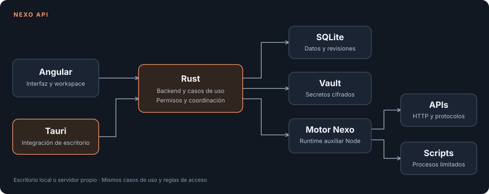

[](README.md)
[](README.es.md)

# Nexo API

**Tus APIs. Tu workspace. Tu infraestructura.**

[](LICENSE)
[](https://github.com/DaftyCode/nexo_api/actions/workflows/desktop.yml)
[](https://github.com/DaftyCode/nexo_api/releases)

Nexo API es una aplicación **100% open source**, con licencia MIT, para construir, organizar, ejecutar y probar APIs desde tu equipo.

Nos inspiramos en Postman y en la comodidad de reunir peticiones, colecciones, entornos y pruebas en un mismo lugar. A partir de esa inspiración estamos construyendo un proyecto independiente, con implementación propia y una arquitectura basada en **Tauri + Rust + Angular**.

Queremos una herramienta ágil, que arranque rápido, responda con fluidez y mantenga tus datos bajo tu control. Rust ejecuta el backend nativo y Tauri integra el WebView del sistema para el escritorio. Las peticiones, los scripts, los protocolos, los mocks y los datasets también se ejecutan en Rust, dentro del mismo proceso; los scripts usan un sandbox QuickJS embebido. Node solo hace falta para compilar la interfaz, nunca para ejecutar la aplicación. Publicaremos mediciones reproducibles de arranque, memoria y latencia a medida que avance el proyecto.

El proyecto está en fase inicial. Las contribuciones, ideas, pruebas y revisiones son bienvenidas.

## Qué puedes hacer

| Área               | Disponible                                                                                                                           |
| ------------------ | ------------------------------------------------------------------------------------------------------------------------------------ |
| Peticiones         | HTTP/HTTPS, métodos, parámetros, cabeceras y respuestas; cuerpos raw, JSON, formularios de texto y GraphQL sobre HTTP.               |
| Organización       | Colecciones y carpetas, pestañas, entornos, variables, historial y documentos persistidos en SQLite.                                 |
| Autenticación HTTP | Todos los tipos de Postman, Bruno e Insomnia: Basic, Bearer, API key, Digest, OAuth 1.0, OAuth 2.0 (todos los flujos, PKCE, inicio de sesión en el navegador, tokens en el vault, renovación y obtención automáticas), AWS Signature v4, Hawk, NTLM, JWT Bearer, Atlassian ASAP, Akamai EdgeGrid, WSSE y Netrc; heredada de carpetas y colecciones. |
| Scripts y pruebas  | Pre-request y scripts de respuesta, variables por ámbito, `nx.test`, `nx.expect`, `nx.sendRequest`, logs y resultados de aserciones. |
| Runner             | Colecciones con iteraciones y datos JSON/CSV, scripts heredados, progreso, cancelación y reportes JSON/JUnit desde CLI.              |
| Protocolos         | Clientes WebSocket, Socket.IO, MQTT y gRPC con proto proporcionado.                                                                  |
| Importación        | Colecciones JSON portables, entornos, OpenAPI/Swagger JSON o YAML, HAR y cURL.                                                       |
| Código             | Generadores propios para cURL, JavaScript/Node, Python, Java, Go, Rust, C# y PowerShell.                                             |
| Herramientas       | Mocks HTTP locales, datasets JSON/CSV con consultas SQL de lectura, Git local y cliente/servidor MCP.                                |
| Secretos           | Vault cifrado con AES-GCM, referencias `{{vault:nombre}}` y redacción de secretos en resultados.                                     |
| Workspaces         | Varios workspaces locales, historial de documentos y revisiones para evitar sobrescrituras.                                          |
| Escritorio y web   | Aplicación de escritorio con Tauri o la misma interfaz en el navegador mediante un lanzador local si no puedes instalar la app.       |

Las peticiones salen desde tu equipo. Con `NEXO_EGRESS=deny-private` se rechazan destinos privados y de loopback, salvo tus propios mocks; `NEXO_EGRESS_ALLOW` define excepciones.

### Plantillas del workspace

El código incluye tres plantillas, seleccionables desde **Template**: **Aurora** (la oscura predeterminada), **Studio** (tres columnas con contexto del entorno y de la petición) y **Canvas** (clara, con petición y respuesta en paralelo). Todas comparten colecciones, entornos, variables, historial y herramientas. Cambiar de plantilla conserva la petición abierta y guarda tu preferencia en ese dispositivo. En Canvas se accede a la navegación desde **Tools** y **Browse collections**. Classic se ha retirado.

Estas plantillas se incluirán en la próxima versión de escritorio; los instaladores publicados de `v0.1.0` conservan su interfaz original.

### Idiomas de la interfaz

El código incluye **inglés y español**, con selector en la web, la documentación y el workspace. Transloco actualiza textos, menús, formularios, accesibilidad y mensajes conocidos de la aplicación al instante, sin recargar. La preferencia se guarda en ese dispositivo; el inglés es el idioma predeterminado y de respaldo. El idioma y la plantilla son preferencias independientes. Los cuerpos de peticiones, respuestas, scripts, valores de variables y nombres de tus recursos se conservan.

Las traducciones están en `src/app/infrastructure/i18n/en.json` y `es.json`. Los mensajes simples usan el texto original en inglés como identificador; los mensajes con parámetros utilizan claves con nombre. Añade las entradas correspondientes en ambos catálogos y ejecuta `npm run i18n:check` para comprobar cobertura y parámetros. Un idioma nuevo también debe registrarse en el catálogo de idiomas, los proveedores y el selector. Los diagnósticos del servidor o motor sin traducción conservan su texto original.

## Descargar e instalar

Las versiones se distribuirán en [GitHub Releases](https://github.com/DaftyCode/nexo_api/releases). Consulta los assets de cada versión: una plataforma preparada en CI no implica que ya exista un instalador publicado para ella.

| Sistema | Arquitectura                        | Paquetes preparados en CI                          |
| ------- | ----------------------------------- | -------------------------------------------------- |
| Windows | x64                                 | Instalador NSIS `.exe` y Windows Installer `.msi`. |
| macOS   | Apple Silicon e Intel, por separado | Aplicación `.app` dentro de `.dmg`.                |
| Linux   | x64                                 | `.deb`, `.rpm` y `.AppImage`.                      |

Cada compilación se realiza en un runner del sistema correspondiente. Los instaladores son autosuficientes: los usuarios finales no necesitan instalar Node ni Rust.

### Microsoft Store

La publicación en Microsoft Store está en preparación. La Store firma el paquete y mantiene la app actualizada, así que no hace falta un certificado de firma. `npm run desktop:msix` compila la app de escritorio y la empaqueta como MSIX con `makeappx` del Windows SDK (`winget install --id Microsoft.WindowsSDK.10.0.26100 --exact` si falta). La identidad de la Store viene de Partner Center mediante `NEXO_MSIX_NAME`, `NEXO_MSIX_PUBLISHER` y `NEXO_MSIX_PUBLISHER_NAME`, que en la CI son variables del repositorio. Sin ellas, el script genera un paquete local de prueba.

### WinGet y despliegue empresarial

El pipeline genera manifiestos WinGet con el identificador propuesto `DaftyCode.NexoAPI`, URLs de la release y SHA-256 calculados sobre el MSI real. **La entrada en el catálogo público está pendiente**: primero hay que publicar una versión y enviar los manifiestos a [microsoft/winget-pkgs](https://github.com/microsoft/winget-pkgs).

Después de su aceptación, el comando previsto será:

```powershell
winget install --exact --id DaftyCode.NexoAPI --source winget
```

El MSI también permite a los equipos de IT desplegar el software con sus herramientas habituales. WinGet sigue utilizando un instalador y respeta las políticas de la empresa; no evita restricciones de ejecución o de confianza en el editor. La firma de Windows y la validación en entornos corporativos están pendientes.

### Homebrew en macOS

Al publicar una release, el workflow `Update package manager index` genera el cask con checksums para Apple Silicon e Intel y lo incorpora a este repositorio. **Hasta la primera release publicada y la ejecución correcta de ese workflow, el cask todavía no estará disponible.** Después:

```bash
brew tap daftycode/nexo https://github.com/DaftyCode/nexo_api
brew install --cask daftycode/nexo/nexo-api
```

Usaremos un tap propio; la inclusión en el catálogo central de Homebrew es un paso distinto. Los builds de CI usan firma ad hoc en macOS. La firma Developer ID y la notarización de Apple requieren configurar los certificados y credenciales de distribución; siguen pendientes.

### Linux con APT o DNF

Cuando estén publicados, los paquetes descargados de una release podrán instalarse con el gestor de la distribución:

```bash
# Debian / Ubuntu, desde la carpeta de descarga:
sudo apt install ./Nexo*.deb

# Fedora / distribuciones compatibles con RPM:
sudo dnf install ./Nexo*.rpm
```

Los equipos de IT pueden distribuir estos paquetes mediante sus repositorios internos. Un repositorio APT/YUM público, con índices y firma propios, está pendiente; todavía no existe un `apt install nexo-api` desde los repositorios del sistema. Flatpak y otros catálogos están en la hoja de ruta.

## Cómo funciona



Nexo funciona para una persona en su equipo. El escritorio inicia un servicio Rust en un puerto aleatorio de loopback y se autentica con un token propio de cada ejecución. La versión web usa el mismo servicio: su lanzador solo escucha en loopback y abre el navegador con un enlace de un solo uso que se convierte en una cookie de sesión HttpOnly. Las peticiones necesitan un Host de loopback, un Origin permitido y la cabecera del cliente Nexo, de modo que otras webs y otros equipos no pueden usar el servicio. Los datos se guardan en la carpeta de datos de la aplicación; los secretos se cifran con una clave guardada en el almacén de credenciales del sistema.

## Arquitectura que queremos mantener

### Backend: hexagonal

```text
backend/crates/
  nexo-domain/          Entidades, reglas y errores del dominio
  nexo-application/     Casos de uso y puertos
  nexo-infrastructure/  Adaptadores SQLite, Git y almacén de credenciales
  nexo-engine/          Adaptador de ejecución: HTTP, scripts QuickJS, protocolos, mocks, datasets, vault
  nexo-http/            Adaptador HTTP
  nexo-server/          Raíz de composición y CLI
src-tauri/             Raíz de composición de escritorio
```

El dominio no conoce HTTP, bases de datos ni interfaz gráfica. Los casos de uso dependen de contratos; los adaptadores implementan esos contratos. Tauri y el servidor componen las mismas capacidades.

### Frontend: Clean Architecture

```text
src/app/
  domain/          Modelos y reglas independientes de Angular
  application/     Casos de uso y contratos
  infrastructure/  Implementaciones de los contratos
  presentation/    Componentes, estado y vistas Angular
  composition/     Inyección y configuración de dependencias
```

La presentación llama a los casos de uso. Los detalles HTTP y de archivos quedan en infraestructura. Usamos componentes standalone, signals, OnPush, Signal Forms y rutas lazy.

Aplicamos **SOLID y Clean Code**: una responsabilidad clara por módulo; puertos pequeños; dependencias hacia las capas interiores; implementaciones intercambiables; nombres concretos y funciones que hagan una sola cosa. Las abstracciones deben resolver una necesidad real. `npm run test:architecture` comprueba límites entre capas.

## Compilar el escritorio desde un repositorio recién descargado

Descarga y extrae el ZIP del repositorio, o clónalo:

```bash
git clone https://github.com/DaftyCode/nexo_api.git
cd nexo_api
```

Ejecuta los comandos desde la raíz del repositorio, donde está `package.json`. **Compila en el sistema operativo y la arquitectura que quieras distribuir.** La CI genera por separado Windows x64, macOS Apple Silicon, macOS Intel y Linux x64. Los scripts no implementan compilación cruzada ni un paquete universal para macOS.

### Instalación en un paso en este equipo

Descarga o clona el repositorio, abre una terminal en su carpeta y ejecuta el script de tu sistema operativo. No hace falta instalar nada antes ni se abre ningún instalador `.exe`, así que también sirve en equipos de empresa que solo permiten las herramientas de paquetes del sistema.

| Objetivo | Windows (PowerShell) | macOS / Linux (Terminal) |
| --- | --- | --- |
| Instalar la app de escritorio | `.\install-desktop.ps1` | `bash install-desktop.sh` |
| Instalar y abrir la versión web | `.\install-web.ps1` | `bash install-web.sh` |

Si PowerShell no permite ejecutar scripts en este equipo, lánzalos solo para esta ejecución con `powershell -ExecutionPolicy Bypass -File .\install-desktop.ps1` (o `install-web.ps1`). Si tu empresa también lo bloquea, pide a IT que despliegue el `.msi` de las releases.

**Qué preparan los scripts si falta algo.** Node (el archivo oficial, con su checksum verificado) y Rustup se descargan dentro del proyecto. Los requisitos del sistema se instalan con las herramientas de paquetes del sistema operativo:

- Windows: WinGet instala las C++ Build Tools, el runtime WebView2 y Git.
- macOS: las Xcode Command Line Tools.
- Linux: APT o DNF instalan el compilador, WebKitGTK y las herramientas de empaquetado.

Pueden aparecer avisos de administrador, licencias o un reinicio. Acéptalos y vuelve a ejecutar el mismo comando. En Windows, WinGet viene con el Instalador de aplicaciones de Microsoft Store. Si tu empresa lo ha retirado, instala los requisitos a través del departamento de IT o usa `-SkipSystemInstall`.

**Escritorio** (`install-desktop`) detecta el sistema operativo y compila solo su paquete:

- Windows: el `.msi`, instalado con `msiexec` (Windows Installer). Windows pide permisos de administrador una vez.
- Linux: el `.deb` con APT, o el `.rpm` con DNF o Zypper. En otras distribuciones, el AppImage se instala en `~/.local/bin` con una entrada en el menú.
- macOS: la `.app`, copiada en Aplicaciones.

Después abre la app. Opciones: `-Package`/`--package <archivo>` instala un paquete que ya tengas, `-NoLaunch`/`--no-launch` no la abre y `-SkipSystemInstall`/`--skip-system-install` usa las herramientas ya instaladas.

**Web** (`install-web`) es para equipos donde no se puede instalar la app de escritorio:

- Si no está instalada: compila la interfaz y el servidor local, lo arranca en segundo plano en `http://127.0.0.1:4000` y abre el navegador con la sesión iniciada.
- Si está instalada pero parada: la arranca en unos segundos, sin compilar nada.
- Si ya está en marcha: solo abre una sesión nueva en el navegador.

Si el código cambió desde la instalación, el script lo avisa; actualiza con `-Rebuild`/`--rebuild`. Otras opciones: `-Stop`/`--stop`, `-Status`/`--status` y `-NoOpen`/`--no-open`, que muestra el enlace de acceso en lugar de abrir el navegador. `NEXO_WEB_PORT` cambia el puerto. La versión web solo escucha en este equipo y comparte los datos con la app de escritorio; los registros están en `.nexo-web/logs`.

### Preparación y compilación automáticas

No tienes que descargar Node, Rust ni las dependencias npm a mano. Los scripts:

1. Reutilizan la versión Node fijada en [.node-version](.node-version), o descargan su archivo oficial y verifican el SHA-256 antes de extraerlo.
2. Comprueban las herramientas nativas y preparan las dependencias que falten mediante WinGet en Windows, el instalador de Apple en macOS o APT/DNF en Linux.
3. Instalan Rustup si falta, verificando su descarga oficial, y preparan la versión Rust de [rust-toolchain.toml](rust-toolchain.toml) para el compilador nativo (MSVC en Windows).
4. Ejecutan `npm ci`, preparan el motor incluido, compilan Angular y Rust y generan los paquetes nativos.

La primera ejecución necesita Internet y puede descargar varios GB de SDK y toolchains. Los instaladores del sistema pueden pedir permisos de administrador, aceptar sus condiciones o reiniciar. Completa esos pasos y vuelve a ejecutar el mismo comando si la preparación se detiene. El script no acepta acuerdos de Microsoft o Apple por ti. Una compilación desde cero **no funciona sin conexión**.

**Windows x64 — PowerShell**

```powershell
.\build.ps1
```

WinGet debe estar disponible mediante el [Instalador de aplicación de Microsoft](https://learn.microsoft.com/es-es/windows/package-manager/winget/). El script lo usa para preparar C++, WebView2 y Git cuando falten. Si tu organización bloquea scripts PowerShell o instalaciones, utiliza su procedimiento autorizado o la opción de GitHub Actions indicada más abajo.

Puedes conservar una instalación Rust GNU/MinGW existente. El script selecciona la versión fijada de `x86_64-pc-windows-msvc` para la compilación y sus procesos hijos, y la instala si falta. No cambia el Rust predeterminado global ni las excepciones por directorio. Si existe `RUSTUP_TOOLCHAIN`, sustituye su selección solo dentro del proceso de compilación y lo indica en la salida; si `CARGO_BUILD_TARGET` solicita otro destino, se detiene con un mensaje específico.

**macOS — Terminal, en Apple Silicon o Intel**

```bash
bash build.sh
```

Si aparece el instalador de Command Line Tools de Apple, complétalo y repite el comando. La compilación local usa firma ad hoc por defecto (`APPLE_SIGNING_IDENTITY=-`), igual que la CI. No genera una firma Developer ID ni notariza la app; consulta la [guía de firma de macOS de Tauri](https://v2.tauri.app/distribute/sign/macos/) para las credenciales de distribución.

**Linux — Terminal, en Ubuntu/Debian o Fedora**

```bash
bash build.sh
```

El script prepara compilador, WebKitGTK, OpenSSL, D-Bus y herramientas de empaquetado mediante APT o DNF, usando `sudo` si hace falta. Ubuntu 22.04 x64 es la referencia de la CI. En otras distribuciones instala las [dependencias nativas de Tauri](https://v2.tauri.app/start/prerequisites/) y ejecuta el mismo script con `--skip-system-install`. Genera AppImages en la distribución más antigua que quieras admitir; consulta la [compatibilidad de AppImage en Tauri](https://v2.tauri.app/distribute/appimage/).

### Dónde se generan los paquetes

| Sistema de compilación | Salida relativa a la raíz del repositorio                                                                          |
| ---------------------- | ------------------------------------------------------------------------------------------------------------------ |
| Windows                | `target/release/bundle/nsis/*-setup.exe` y `target/release/bundle/msi/*.msi`                                       |
| macOS                  | `target/release/bundle/macos/Nexo API.app` y `target/release/bundle/dmg/*.dmg`                                     |
| Linux                  | `target/release/bundle/appimage/*.AppImage`, `target/release/bundle/deb/*.deb` y `target/release/bundle/rpm/*.rpm` |

Instala o copia el **paquete generado**. El binario suelto de `target/release/` no incluye por sí solo todos los recursos del runtime. La app empaquetada incluye el motor necesario; sus usuarios no necesitan instalar Node ni Rust.

Node y las herramientas descargadas se guardan en `.build-tools/`, excluida de Git. Rustup utiliza sus directorios habituales del usuario; los SDK nativos se instalan en el sistema. Las dependencias y los resultados de compilación también están excluidos. Las siguientes ejecuciones reutilizan herramientas y cachés; los gestores pueden seguir accediendo a Internet.

### Opciones útiles

| Objetivo                                                    | PowerShell                       | macOS/Linux                                                                   |
| ----------------------------------------------------------- | -------------------------------- | ----------------------------------------------------------------------------- |
| Comprobar requisitos sin instalar ni compilar               | `.\build.ps1 -Check`             | `bash build.sh --check`                                                       |
| Preparar herramientas sin instalar paquetes npm ni compilar | `.\build.ps1 -ToolsOnly`         | `bash build.sh --tools-only`                                                  |
| Preparar herramientas y paquetes npm sin compilar           | `.\build.ps1 -PrepareOnly`       | `bash build.sh --prepare-only`                                                |
| Usar los SDK existentes sin instalar paquetes del sistema   | `.\build.ps1 -SkipSystemInstall` | `bash build.sh --skip-system-install`                                         |
| Generar un único formato                                    | `.\build.ps1 -Bundles nsis`      | `bash build.sh --bundles dmg` (macOS) o `bash build.sh --bundles deb` (Linux) |

Las opciones pueden combinarse. El modo de comprobación informa si falta la versión de Node y no la descarga. Los MSI necesitan la característica opcional VBScript de Windows; si WiX muestra `failed to run light.exe`, consulta los [requisitos de MSI de Tauri](https://v2.tauri.app/distribute/windows-installer/#building) o genera solo NSIS con `-Bundles nsis`. Si falla `link.exe`, revisa la carga de trabajo de C++ y Windows SDK. Para errores `pkg-config` en Linux, comprueba los paquetes de desarrollo WebKitGTK **4.1**.

Si una versión anterior se detiene con `Node and Rust must use the same native architecture`, actualiza el repositorio y repite la compilación. Esa comprobación también presentaba los fallos de Rustup o una instalación GNU como errores de arquitectura. El script actual comprueba el compilador nativo seleccionado mediante `rustc -vV` y conserva el detalle de Rustup si no puede ejecutarlo. En equipos corporativos, las descargas necesitan acceso mediante la configuración de red o proxy autorizada por tu organización.

Si `npm ci` muestra `EBUSY` sobre Sass o esbuild en Windows, detén las sesiones `npm run dev`, `ng serve`, desarrollo de escritorio y watch/tests de este repositorio antes de repetirlo. No ejecutes la preparación a la vez que el servidor de desarrollo: `npm ci` reemplaza `node_modules`. El aviso `EBADENGINE` con Node 24 indica que la terminal usa otra versión; `build.ps1` utiliza el Node 26.13 preparado sin sustituir la instalación global de tu equipo.

### Compilación manual y desarrollo

Si prefieres gestionar las herramientas, instala Git, Node **26.13.0** con npm, Rustup y los [requisitos de tu sistema](https://v2.tauri.app/start/prerequisites/). En Windows selecciona **Desarrollo para el escritorio con C++**, Windows SDK y WebView2. En macOS utiliza `xcode-select --install`. Abre otra terminal después de instalar las herramientas. Desde el repositorio clonado:

```bash
node --version
npm --version
rustup show active-toolchain
npm ci
```

Elige el comando nativo correspondiente:

```powershell
# Windows x64:
npm run desktop:build -- --bundles nsis,msi
```

```bash
# macOS (por separado en Apple Silicon e Intel):
APPLE_SIGNING_IDENTITY=- npm run desktop:build -- --bundles app,dmg

# Linux:
NO_STRIP=true npm run desktop:build -- --bundles appimage,deb,rpm
```

`desktop:build` genera instaladores nativos. `build:desktop` solo compila la interfaz Angular y **no** genera un instalador. No ejecutes varias compilaciones a la vez sobre el mismo repositorio.

Para desarrollar el escritorio, después de `npm ci`, ejecuta `npm run desktop:dev`.

Para desarrollo web ejecuta `npm run dev`. Abre [http://localhost:4200/workspace](http://localhost:4200/workspace); el backend utiliza loopback en 8080 y guarda sus datos en `.nexo/`. Detén el desarrollo web antes de iniciar `desktop:dev`, porque ambos usan el puerto 4200.

### Compilar todas las plataformas sin instalar herramientas locales

Haz un fork, entra en **Actions → Desktop packages → Run workflow** y elige tu rama. El workflow compila los cuatro destinos nativos en los runners Windows, macOS y Linux de GitHub. Descarga los artefactos `nexo-*` al terminar; se conservan durante 14 días. Una ejecución manual no publica una release. Actions debe estar habilitado en el fork y se aplican los límites de uso de GitHub.

### Node solo se usa para compilar

npm y Angular CLI compilan la interfaz en el equipo de desarrollo o en CI, con la versión de [.node-version](.node-version). La aplicación instalada, el lanzador web y la CLI no incluyen ningún runtime Node: el crate Rust `nexo-engine` ejecuta peticiones, scripts (QuickJS con límites de memoria y tiempo y sin acceso al sistema), WebSocket, Socket.IO, MQTT, gRPC, mocks, datasets, llamadas OAuth/MCP y el vault cifrado. Los vaults creados por versiones anteriores siguen siendo legibles.

### Versión web local

Si el equipo de la empresa no permite instalar la app de escritorio, ejecuta `.\install-web.ps1` o `bash install-web.sh`, o arranca el lanzador directamente:

```bash
npm run build
npm run backend:build
target/release/nexo-server --web dist/nexo/browser
```

El lanzador solo escucha en `127.0.0.1` y muestra un enlace de acceso válido una vez durante dos minutos. Si lo ejecutas de nuevo mientras está activo, abre una sesión nueva en la instancia existente. No es un servidor multiusuario: no lo publiques detrás de un proxy.

### CLI

```bash
npm run nexo -- run collection.json --environment environment.json --iterations 5 --data rows.json --report result.json --junit result.xml
npm run nexo -- request request.json
npm run nexo -- import specification.yaml --report collection.json
```

La CLI ejecuta el mismo motor Rust en su propio proceso y devuelve un código de error cuando falla una ejecución o una aserción.

## Estado y siguientes pasos

Ya hay pruebas de peticiones reales, variables, scripts, aserciones, cancelación, cookies, redacción de secretos, importación OpenAPI, código generado ejecutable, runner con datos, gRPC unary y streaming, WebSocket, Socket.IO, MQTT, política de salida, control de acceso local y revisiones. Las pruebas de contrato de `tests/contract` usan el binario real del servidor.

Quedan áreas importantes por completar:

- Validar los instaladores nuevos en máquinas limpias de Windows, macOS y Linux; firma, notarización, actualización automática y publicación en catálogos.
- Publicar mediciones de arranque, memoria y latencia.
- Subida de archivos binarios, gestión persistente de cookies y más ayudas de autenticación.
- Flujo OAuth con navegador/callback automático, introspección y subscriptions GraphQL, reflexión gRPC y más variantes de protocolos.
- Pausa/reanudación del runner, más funciones de scripts y pruebas completas de proxy y mTLS.
- Colaboración en tiempo real, comentarios, sincronización entre instalaciones y monitorización programada.
- Repositorios APT/YUM firmados y distribución Flatpak.

Los límites actuales incluyen 5 segundos y 128 MB de memoria por evaluación de script, ocho ejecuciones activas y respuestas limitadas para la interfaz. Las cookies se guardan por workspace en la carpeta de datos. Aún no se admiten eventos binarios de Socket.IO ni MQTT 5. Los `$ref` externos de OpenAPI deben agruparse antes de importar. Los tipos de autorización desconocidos se rechazan expresamente. La compatibilidad de protocolos y formatos seguirá creciendo con casos de prueba reproducibles.

## Colaborar

Puedes abrir una [issue](https://github.com/DaftyCode/nexo_api/issues), proponer una mejora, corregir un fallo, ampliar pruebas o enviar una pull request. No necesitas permiso previo para empezar. Para cambios grandes, una issue con el problema y la propuesta ayuda a coordinar el trabajo.

1. Haz un fork y crea una rama corta: `feat/http-history`, `fix/runner-cancel` o similar.
2. Mantén cada cambio centrado en un problema y respeta las capas y responsabilidades.
3. Añade pruebas de comportamiento cuando cambies reglas o adaptadores. Incluye un caso que reproduzca el fallo si corriges uno.
4. Ejecuta las comprobaciones relevantes y explica en la PR el problema, el resultado y cómo lo verificaste.
5. Conserva los avisos y licencias de las dependencias. Evita incluir datos locales, credenciales o artefactos generados.

### Commits

Usamos Conventional Commits, con asunto breve y alcance cuando ayude:

```text
feat(runner): support data-driven iterations
fix(vault): redact secrets from execution logs
refactor(domain): separate request validation
test(http): cover cross-origin redirects
docs(readme): explain the local web version
chore(packages): update installer manifests
```

Un commit debe tener una intención clara. Explica el motivo en el cuerpo si no se deduce del cambio. Usa `!` y `BREAKING CHANGE:` cuando cambies un contrato de forma incompatible. Las PR deben mantener la arquitectura hexagonal del backend, Clean Architecture en frontend y los principios SOLID.

### Revisión de mantenedores

La rama principal se llama actualmente `master`. Las contribuciones deben llegar mediante pull request y necesitan una aprobación de un code owner; [CODEOWNERS](.github/CODEOWNERS) asigna por ahora esa revisión a **@DaftyCode**. Los commits nuevos invalidan las aprobaciones anteriores, las conversaciones deben estar resueltas y se bloquean los pushes forzados y el borrado de la rama para colaboradores. El propietario del repositorio personal conserva la excepción de administrador. La regla también cubre `main` si se utiliza ese nombre después.

Para incorporar mantenedores, invítalos con permiso de escritura y añade sus usuarios de GitHub al primer patrón de propietarios. Los cambios en `CODEOWNERS` y workflows seguirán necesitando al propietario. Otras personas pueden dejar revisiones, pero su aprobación no sustituye la obligatoria de un code owner. La automatización de los índices de paquetes propone sus cambios para revisión en vez de escribir directamente en la rama principal.

### Comprobaciones

```bash
npm run test:architecture
npm run lint
npm test -- --watch=false
npm run engine:test
npm run e2e
npm run test:packages
npm run backend:test
npm run backend:clippy
npm run build
npm run build:desktop
npm run test:server
```

`engine:test` compila `nexo-server` y ejecuta contra él las pruebas de contrato. `e2e` prueba la interfaz compilada (`npm run build`) con Playwright y revisa la accesibilidad con axe; ejecuta una vez `npx playwright install chromium`. `test:server` necesita el backend release. Los informes se generan en `.verification`, fuera de Git. La carpeta local `docs/` también está excluida y no forma parte del repositorio.

## Publicar una versión

`Desktop packages` puede ejecutarse manualmente desde Actions para comprobar los cuatro builds sin publicar una release. Un tag `vX.Y.Z` que coincida con las versiones del proyecto genera un **borrador de GitHub Release**, instaladores, `SHA256SUMS` y manifiestos WinGet/Homebrew. Tras publicar el borrador, el workflow del índice propone el cask y los manifiestos en una rama independiente y abre una PR cuando lo permiten los ajustes del repositorio. Si no, deja la rama y los artefactos preparados para que el propietario abra la PR. El propietario revisa e incorpora esos cambios.

El registro público en WinGet necesita una PR independiente al catálogo oficial. La preparación de paquetes y manifiestos no equivale a su aceptación en un gestor.

## Licencia

Nexo API se distribuye bajo [MIT](LICENSE): puedes usarlo, estudiarlo, modificarlo, redistribuirlo y colaborar, también en entornos comerciales. Las dependencias mantienen sus respectivas licencias.
