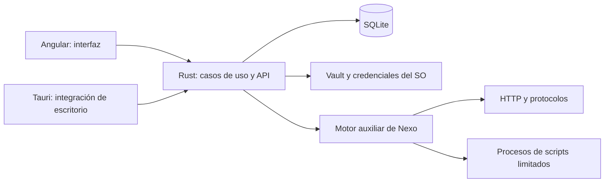

# Nexo API

**Tus APIs. Tu workspace. Tu infraestructura.**

[](LICENSE)
[](https://github.com/DaftyCode/nexo_api/actions/workflows/desktop.yml)
[](https://github.com/DaftyCode/nexo_api/releases)

Nexo API es una aplicación **100% open source**, con licencia MIT, para construir, organizar, ejecutar y probar APIs desde tu equipo o desde tu propio servidor.

Nos inspiramos en Postman y en la comodidad de reunir peticiones, colecciones, entornos y pruebas en un mismo lugar. A partir de esa inspiración estamos construyendo un proyecto independiente, con implementación propia y una arquitectura basada en **Tauri + Rust + Angular**.

Queremos una herramienta ágil, que arranque rápido, responda con fluidez y mantenga tus datos bajo tu control. Rust ejecuta el backend nativo y Tauri integra el WebView del sistema para el escritorio. El motor de peticiones y scripts todavía utiliza un runtime Node auxiliar, incluido en el instalador; seguir trasladando trabajo a Rust forma parte de la hoja de ruta. Publicaremos mediciones reproducibles de arranque, memoria y latencia a medida que avance el proyecto.

El proyecto está en fase inicial. Las contribuciones, ideas, pruebas y revisiones son bienvenidas.

## Qué puedes hacer

| Área               | Disponible                                                                                                                           |
| ------------------ | ------------------------------------------------------------------------------------------------------------------------------------ |
| Peticiones         | HTTP/HTTPS, métodos, parámetros, cabeceras y respuestas; cuerpos raw, JSON, formularios de texto y GraphQL sobre HTTP.               |
| Organización       | Colecciones y carpetas, pestañas, entornos, variables, historial y documentos persistidos en SQLite.                                 |
| Autenticación HTTP | Basic, Bearer, API key, Digest MD5/SHA-256 y uso de tokens OAuth2; intercambio de tokens en el panel de integraciones.               |
| Scripts y pruebas  | Pre-request y scripts de respuesta, variables por ámbito, `nx.test`, `nx.expect`, `nx.sendRequest`, logs y resultados de aserciones. |
| Runner             | Colecciones con iteraciones y datos JSON/CSV, scripts heredados, progreso, cancelación y reportes JSON/JUnit desde CLI.              |
| Protocolos         | Clientes WebSocket, Socket.IO, MQTT y gRPC con proto proporcionado.                                                                  |
| Importación        | Colecciones JSON portables, entornos, OpenAPI/Swagger JSON o YAML, HAR y cURL.                                                       |
| Código             | Generadores propios para cURL, JavaScript/Node, Python, Java, Go, Rust, C# y PowerShell.                                             |
| Herramientas       | Mocks HTTP locales, datasets JSON/CSV con consultas SQL de lectura, Git local y cliente/servidor MCP.                                |
| Secretos           | Vault cifrado con AES-GCM, referencias `{{vault:nombre}}` y redacción de secretos en resultados.                                     |
| Servidor           | Cuentas, sesiones revocables, workspaces, miembros, roles y revisiones para evitar sobrescrituras.                                   |
| Escritorio y web   | Aplicación local con Tauri; web con Angular SSR para portada/documentación y editor privado en cliente.                              |

Las peticiones se envían desde el motor local o desde el servidor donde lo despliegues. En modo servidor, una URL de red privada se interpreta desde la red de ese servidor.

## Descargar e instalar

Las versiones se distribuirán en [GitHub Releases](https://github.com/DaftyCode/nexo_api/releases). Consulta los assets de cada versión: una plataforma preparada en CI no implica que ya exista un instalador publicado para ella.

| Sistema | Arquitectura                        | Paquetes preparados en CI                          |
| ------- | ----------------------------------- | -------------------------------------------------- |
| Windows | x64                                 | Instalador NSIS `.exe` y Windows Installer `.msi`. |
| macOS   | Apple Silicon e Intel, por separado | Aplicación `.app` dentro de `.dmg`.                |
| Linux   | x64                                 | `.deb`, `.rpm` y `.AppImage`.                      |

Cada compilación se realiza en un runner del sistema correspondiente. Los instaladores incluyen el runtime auxiliar, por lo que los usuarios finales no necesitan instalar Node ni Rust.

### WinGet y despliegue empresarial

El pipeline genera manifiestos WinGet con el identificador propuesto `DaftyCode.NexoAPI`, URLs de la release y SHA-256 calculados sobre el MSI real. **La entrada en el catálogo público está pendiente**: primero hay que publicar una versión y enviar los manifiestos a [microsoft/winget-pkgs](https://github.com/microsoft/winget-pkgs).

Después de su aceptación, el comando previsto será:

```powershell
winget install --exact --id DaftyCode.NexoAPI --source winget
```

El MSI también permite a los equipos de IT desplegar el software con sus herramientas habituales. WinGet sigue utilizando un instalador y respeta las políticas de la empresa; no evita restricciones de ejecución o de confianza en el editor. La firma de Windows y la validación en entornos corporativos están pendientes.

### Homebrew en macOS

Al publicar una release, el workflow `Update package manager index` genera el cask con checksums para Apple Silicon e Intel y lo incorpora a este repositorio. **Hasta la primera release publicada y la ejecución correcta de ese workflow, el cask todavía no estará disponible.** Después:

```bash
brew tap daftycode/nexo https://github.com/DaftyCode/nexo_api
brew install --cask daftycode/nexo/nexo-api
```

Usaremos un tap propio; la inclusión en el catálogo central de Homebrew es un paso distinto. Los builds de CI usan firma ad hoc en macOS. La firma Developer ID y la notarización de Apple requieren configurar los certificados y credenciales de distribución; siguen pendientes.

### Linux con APT o DNF

Cuando estén publicados, los paquetes descargados de una release podrán instalarse con el gestor de la distribución:

```bash
# Debian / Ubuntu, desde la carpeta de descarga:
sudo apt install ./Nexo*.deb

# Fedora / distribuciones compatibles con RPM:
sudo dnf install ./Nexo*.rpm
```

Los equipos de IT pueden distribuir estos paquetes mediante sus repositorios internos. Un repositorio APT/YUM público, con índices y firma propios, está pendiente; todavía no existe un `apt install nexo-api` desde los repositorios del sistema. Flatpak y otros catálogos están en la hoja de ruta.

## Cómo funciona



El escritorio inicia un servicio Rust en un puerto aleatorio de loopback y utiliza un token propio. Conserva sus datos en el equipo y funciona sin cuenta. El modo servidor añade autenticación y permisos por workspace, y puede desplegarse en infraestructura propia.

La portada y `/docs` se renderizan en servidor. El editor `/workspace` se renderiza en cliente, lleva `noindex` y excluye los datos privados del transfer cache de Angular.

## Arquitectura que queremos mantener

### Backend: hexagonal

```text
backend/crates/
  nexo-domain/          Entidades, reglas y errores del dominio
  nexo-application/     Casos de uso y puertos
  nexo-infrastructure/  Adaptadores SQLite, ejecución, Git y vault
  nexo-http/            Adaptador HTTP
  nexo-server/          Raíz de composición y CLI
src-tauri/             Raíz de composición de escritorio
```

El dominio no conoce HTTP, bases de datos ni interfaz gráfica. Los casos de uso dependen de contratos; los adaptadores implementan esos contratos. Tauri y el servidor componen las mismas capacidades.

### Frontend: Clean Architecture

```text
src/app/
  domain/          Modelos y reglas independientes de Angular
  application/     Casos de uso y contratos
  infrastructure/  Implementaciones de los contratos
  presentation/    Componentes, estado y vistas Angular
  composition/     Inyección y configuración de dependencias
```

La presentación llama a los casos de uso. Los detalles HTTP y de archivos quedan en infraestructura. Usamos componentes standalone, signals, OnPush, Signal Forms y rutas lazy.

Aplicamos **SOLID y Clean Code**: una responsabilidad clara por módulo; puertos pequeños; dependencias hacia las capas interiores; implementaciones intercambiables; nombres concretos y funciones que hagan una sola cosa. Las abstracciones deben resolver una necesidad real. `npm run test:architecture` comprueba límites entre capas.

## Ejecutar desde el código

Requisitos: Node LTS 26.13 o superior, npm y la toolchain Rust fijada en `rust-toolchain.toml`. El escritorio necesita las [dependencias de Tauri del sistema](https://v2.tauri.app/start/prerequisites/): MSVC/WebView2 en Windows, Xcode Command Line Tools en macOS y bibliotecas de WebKitGTK en Linux.

```bash
npm ci
npm run engine:build
npm run dev
```

Desarrollo web: [http://localhost:4200/workspace](http://localhost:4200/workspace), con backend local en loopback 8080.

```bash
# Escritorio en desarrollo:
npm run desktop:dev

# Instaladores nativos del sistema actual:
npm run desktop:build
```

En Windows, `node tools/ensure-node.mjs` descarga y verifica el runtime Node oficial que se incluirá en el instalador. En macOS y Linux se incluye el Node utilizado para compilar.

### Servidor propio

```bash
npm run build
npm run backend:build
npm run preview:server
```

Abrir [http://localhost:4000](http://localhost:4000). Este comando inicia SSR y un backend de servidor en loopback 8081, con datos separados en `.nexo-server`. El primer acceso permite crear la cuenta propietaria; el registro posterior está deshabilitado por defecto.

También puedes usar `npm run server:start` y `npm run serve:ssr:nexo` como procesos separados. La web utiliza `NEXO_API_URL`, por defecto `http://127.0.0.1:8080`.

```bash
docker compose up --build -d
```

Configura `.env` a partir de `.env.example`, los orígenes permitidos y un proxy HTTPS para tu dominio. El volumen `nexo-data` conserva documentos, usuarios, revisiones y secretos. La configuración de Compose está validada; queda pendiente verificar el contenedor en ejecución.

### CLI

```bash
npm run nexo -- run collection.json --environment environment.json --iterations 5 --data rows.json --report result.json --junit result.xml
npm run nexo -- request request.json
npm run nexo -- import specification.yaml --report collection.json
```

La CLI comparte el motor de ejecución con el escritorio y el servidor y devuelve un código de error cuando falla una ejecución o una aserción.

## Estado y siguientes pasos

Ya hay pruebas de peticiones reales, variables, scripts, aserciones, cancelación, cookies, redacción de secretos, importación OpenAPI, código generado ejecutable, runner con datos, gRPC unary, WebSocket, Socket.IO, MQTT, permisos, revisiones y SSR.

Quedan áreas importantes por completar:

- Validar los instaladores nuevos en máquinas limpias de Windows, macOS y Linux; firma, notarización, actualización automática y publicación en catálogos.
- Medir rendimiento y seguir trasladando capacidades del runtime auxiliar a Rust.
- Subida de archivos binarios, gestión persistente de cookies y más ayudas de autenticación.
- Flujo OAuth con navegador/callback automático, introspección y subscriptions GraphQL, reflexión gRPC y más variantes de protocolos.
- Pausa/reanudación del runner, más funciones de scripts y pruebas completas de proxy y mTLS.
- Colaboración en tiempo real, comentarios, sincronización entre instalaciones y monitorización programada.
- Repositorios APT/YUM firmados y distribución Flatpak.

Los límites actuales incluyen 5 segundos por evaluación de script, procesos de ejecución de 256 MB y respuestas limitadas para la interfaz. Las cookies duran mientras vive el motor. Los `$ref` externos de OpenAPI deben agruparse antes de importar. Los helpers HTTP aún no implementados se rechazan expresamente. La compatibilidad de protocolos y formatos seguirá creciendo con casos de prueba reproducibles.

## Colaborar

Puedes abrir una [issue](https://github.com/DaftyCode/nexo_api/issues), proponer una mejora, corregir un fallo, ampliar pruebas o enviar una pull request. No necesitas permiso previo para empezar. Para cambios grandes, una issue con el problema y la propuesta ayuda a coordinar el trabajo.

1. Haz un fork y crea una rama corta: `feat/http-history`, `fix/runner-cancel` o similar.
2. Mantén cada cambio centrado en un problema y respeta las capas y responsabilidades.
3. Añade pruebas de comportamiento cuando cambies reglas o adaptadores. Incluye un caso que reproduzca el fallo si corriges uno.
4. Ejecuta las comprobaciones relevantes y explica en la PR el problema, el resultado y cómo lo verificaste.
5. Conserva los avisos y licencias de las dependencias. Evita incluir datos locales, credenciales o artefactos generados.

### Commits

Usamos Conventional Commits, con asunto breve y alcance cuando ayude:

```text
feat(runner): support data-driven iterations
fix(vault): redact secrets from execution logs
refactor(domain): separate request validation
test(http): cover cross-origin redirects
docs(readme): explain self-hosted setup
chore(packages): update installer manifests
```

Un commit debe tener una intención clara. Explica el motivo en el cuerpo si no se deduce del cambio. Usa `!` y `BREAKING CHANGE:` cuando cambies un contrato de forma incompatible. Las PR deben mantener la arquitectura hexagonal del backend, Clean Architecture en frontend y los principios SOLID.

### Comprobaciones

```bash
npm run test:architecture
npm test -- --watch=false
npm run engine:test
npm run test:packages
npm run backend:test
npm run backend:clippy
npm run build
npm run build:desktop
npm run test:server
npm run test:ssr
```

`test:server` necesita el backend release; `test:ssr` necesita el build SSR, backend local en 8080 y el puerto 4000 libre. Los informes se generan en `.verification`, fuera de Git. La carpeta local `docs/` también está excluida y no forma parte del repositorio.

## Publicar una versión

`Desktop packages` puede ejecutarse manualmente desde Actions para comprobar los cuatro builds sin publicar una release. Un tag `vX.Y.Z` que coincida con las versiones del proyecto genera un **borrador de GitHub Release**, instaladores, `SHA256SUMS` y manifiestos WinGet/Homebrew. Después de revisar y publicar el borrador, el workflow del índice añade el cask y los manifiestos al repositorio. Las ramas protegidas pueden requerir adaptar ese paso a una PR.

El registro público en WinGet necesita una PR independiente al catálogo oficial. La preparación de paquetes y manifiestos no equivale a su aceptación en un gestor.

## Licencia

Nexo API se distribuye bajo [MIT](LICENSE): puedes usarlo, estudiarlo, modificarlo, redistribuirlo y colaborar, también en entornos comerciales. Las dependencias mantienen sus respectivas licencias.
