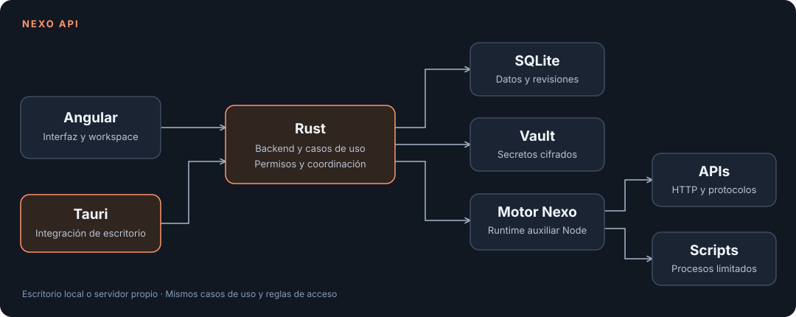

[](README.md)
[](README.es.md)

# Nexo API

**Your APIs. Your workspace. Your infrastructure.**

[](LICENSE)
[](https://github.com/DaftyCode/nexo_api/actions/workflows/desktop.yml)
[](https://github.com/DaftyCode/nexo_api/releases)

Nexo API is a **100% open source** application, licensed under MIT, for building, organizing, running and testing APIs on your computer or your own server.

We take inspiration from Postman and the convenience of keeping requests, collections, environments and tests in one place. From that inspiration, we are building an independent project with its own implementation and an architecture based on **Tauri + Rust + Angular**.

Our goal is a responsive tool that starts quickly, feels smooth and keeps you in control of your data. Rust runs the native backend, while Tauri integrates the operating system's WebView for the desktop interface. The request and scripting engine currently uses an auxiliary Node runtime, included in the installer; moving more work to Rust is part of our roadmap. We will publish reproducible startup, memory and latency benchmarks as the project develops.

The project is at an early stage. Contributions, ideas, testing and code reviews are welcome.

## What you can do

| Area                | Available features                                                                                                        |
| ------------------- | ------------------------------------------------------------------------------------------------------------------------- |
| Requests            | HTTP/HTTPS, methods, query parameters, headers and responses; raw, JSON, text form bodies and GraphQL over HTTP.          |
| Organization        | Collections and folders, tabs, environments, variables, history and documents persisted in SQLite.                        |
| HTTP authentication | Basic, Bearer, API key, MD5/SHA-256 Digest and OAuth2 tokens; token exchange in the integrations panel.                   |
| Scripts and tests   | Pre-request and response scripts, scoped variables, `nx.test`, `nx.expect`, `nx.sendRequest`, logs and assertion results. |
| Runner              | Collection iterations with JSON/CSV data, inherited scripts, progress, cancellation and JSON/JUnit reports from the CLI.  |
| Protocols           | WebSocket, Socket.IO, MQTT and gRPC clients with a supplied proto.                                                        |
| Import              | Portable JSON collections, environments, OpenAPI/Swagger JSON or YAML, HAR and cURL.                                      |
| Code                | Original generators for cURL, JavaScript/Node, Python, Java, Go, Rust, C# and PowerShell.                                 |
| Tools               | Local HTTP mocks, JSON/CSV datasets with read-only SQL queries, local Git and MCP client/server support.                  |
| Secrets             | AES-GCM encrypted vault, `{{vault:name}}` references and secret redaction in results.                                     |
| Server              | Accounts, revocable sessions, workspaces, members, roles and revisions that prevent lost updates.                         |
| Desktop and web     | Local Tauri application; Angular SSR for the public website/documentation and a client-rendered private editor.           |

Requests originate from the local engine or the server where you deploy it. In server mode, private network URLs are resolved from that server's network.

## Download and install

Versions are distributed through [GitHub Releases](https://github.com/DaftyCode/nexo_api/releases). Check each release's assets: a platform configured in CI does not automatically mean an installer has been published for it.

| Operating system | Architecture                              | Packages configured in CI                           |
| ---------------- | ----------------------------------------- | --------------------------------------------------- |
| Windows          | x64                                       | NSIS `.exe` installer and Windows Installer `.msi`. |
| macOS            | Apple Silicon and Intel, built separately | `.app` application inside a `.dmg`.                 |
| Linux            | x64                                       | `.deb`, `.rpm` and `.AppImage`.                     |

Each build runs on a runner for its operating system. Installers include the auxiliary runtime, so end users do not need to install Node or Rust.

### WinGet and enterprise deployment

The pipeline generates WinGet manifests with the proposed identifier `DaftyCode.NexoAPI`, release URLs and SHA-256 hashes calculated from the actual MSI. **Public catalog registration is pending**: a version must be published first, then its manifests submitted to [microsoft/winget-pkgs](https://github.com/microsoft/winget-pkgs).

After acceptance, the intended command will be:

```powershell
winget install --exact --id DaftyCode.NexoAPI --source winget
```

The MSI also lets IT teams deploy the application with their usual management tools. WinGet still uses an installer and follows company policies; it does not bypass execution restrictions or publisher trust requirements. Windows signing and enterprise environment validation are pending.

### Homebrew on macOS

Publishing a release triggers `Update package manager index`, which generates a cask with checksums for Apple Silicon and Intel and adds it to this repository. **The cask becomes available after the first release is published and that workflow succeeds.** Then:

```bash
brew tap daftycode/nexo https://github.com/DaftyCode/nexo_api
brew install --cask daftycode/nexo/nexo-api
```

We use our own tap; inclusion in Homebrew's central catalog is a separate step. CI builds use ad hoc signing on macOS. Apple Developer ID signing and notarization require distribution certificates and credentials, which still need to be configured.

### Linux with APT or DNF

Once published, packages downloaded from a release can be installed using your distribution's package manager:

```bash
# Debian / Ubuntu, from your download directory:
sudo apt install ./Nexo*.deb

# Fedora / compatible RPM distributions:
sudo dnf install ./Nexo*.rpm
```

IT teams can distribute these packages through their internal repositories. A public APT/YUM repository with its own indexes and signing is pending; `apt install nexo-api` is not yet available from system repositories. Flatpak and other catalogs are on the roadmap.

## How it works



The desktop application starts a Rust service on a random loopback port and authenticates with its own token. It stores data locally and works without an account. Server mode adds authentication and workspace permissions and can run on your own infrastructure.

The public website and `/docs` use server rendering. The `/workspace` editor uses client rendering, carries `noindex` and excludes private data from Angular's transfer cache.

## Architecture we want to preserve

### Backend: hexagonal architecture

```text
backend/crates/
  nexo-domain/          Domain entities, rules and errors
  nexo-application/     Use cases and ports
  nexo-infrastructure/  SQLite, execution, Git and vault adapters
  nexo-http/            HTTP adapter
  nexo-server/          Composition root and CLI
src-tauri/             Desktop composition root
```

The domain has no knowledge of HTTP, databases or graphical interfaces. Use cases depend on contracts; adapters implement those contracts. Tauri and the server compose the same capabilities.

### Frontend: Clean Architecture

```text
src/app/
  domain/          Angular-independent models and rules
  application/     Use cases and contracts
  infrastructure/  Contract implementations
  presentation/    Angular components, state and views
  composition/     Dependency injection and configuration
```

Presentation calls use cases. HTTP and file handling stay in infrastructure. We use standalone components, signals, OnPush, Signal Forms and lazy routes.

We follow **SOLID and Clean Code**: clear module responsibilities, small ports, inward dependencies, interchangeable implementations, concrete names and focused functions. Abstractions should solve a real need. `npm run test:architecture` checks layer boundaries.

## Run from source

Requirements: Node LTS 26.13 or newer, npm and the Rust toolchain pinned in `rust-toolchain.toml`. Desktop development also requires [Tauri's platform prerequisites](https://v2.tauri.app/start/prerequisites/): MSVC/WebView2 on Windows, Xcode Command Line Tools on macOS and WebKitGTK libraries on Linux.

```bash
npm ci
npm run engine:build
npm run dev
```

Web development: [http://localhost:4200/workspace](http://localhost:4200/workspace), with a local backend on loopback port 8080.

```bash
# Desktop development:
npm run desktop:dev

# Native installers for your current operating system:
npm run desktop:build
```

On Windows, `node tools/ensure-node.mjs` downloads and verifies the official Node runtime included in the installer. macOS and Linux builds include the Node executable used during the build.

### Self-hosted server

```bash
npm run build
npm run backend:build
npm run preview:server
```

Open [http://localhost:4000](http://localhost:4000). This command starts SSR and a server-mode backend on loopback port 8081, with separate data in `.nexo-server`. The first visit lets you create the owner account; subsequent registration is disabled by default.

You can also run `npm run server:start` and `npm run serve:ssr:nexo` as separate processes. The web server uses `NEXO_API_URL`, defaulting to `http://127.0.0.1:8080`.

```bash
docker compose up --build -d
```

Create `.env` from `.env.example`, configure allowed origins and use an HTTPS reverse proxy for your domain. The `nexo-data` volume persists documents, users, revisions and secrets. The Compose configuration has been validated; running the container still needs verification.

### CLI

```bash
npm run nexo -- run collection.json --environment environment.json --iterations 5 --data rows.json --report result.json --junit result.xml
npm run nexo -- request request.json
npm run nexo -- import specification.yaml --report collection.json
```

The CLI shares the execution engine with the desktop and server and returns an error exit code when a run or assertion fails.

## Current status and next steps

Tests already cover real requests, variables, scripts, assertions, cancellation, cookies, secret redaction, OpenAPI imports, executable generated code, data-driven runs, unary gRPC, WebSocket, Socket.IO, MQTT, permissions, revisions and SSR.

Important work remains:

- Validate the new installers on clean Windows, macOS and Linux machines; signing, notarization, automatic updates and catalog publication.
- Benchmark performance and move more capabilities from the auxiliary runtime into Rust.
- Binary file uploads, persistent cookie management and additional authentication helpers.
- Automatic OAuth browser/callback flows, GraphQL introspection/subscriptions, gRPC reflection and more protocol variants.
- Runner pause/resume, expanded scripting APIs and comprehensive proxy/mTLS tests.
- Real-time collaboration, comments, synchronization between installations and scheduled monitoring.
- Signed APT/YUM repositories and Flatpak distribution.

Current limits include 5 seconds per script evaluation, 256 MB execution processes and response size limits for the interface. Cookies last for the engine's lifetime. External OpenAPI `$ref` references must be bundled before import. Unimplemented HTTP authentication helpers are rejected explicitly. Protocol and format support will grow alongside reproducible test cases.

## Contributing

You can open an [issue](https://github.com/DaftyCode/nexo_api/issues), propose an improvement, fix a bug, expand tests or submit a pull request. You do not need permission to get started. For larger changes, an issue describing the problem and proposal helps coordinate the work.

1. Fork the repository and create a focused branch, such as `feat/http-history` or `fix/runner-cancel`.
2. Keep each change focused on one problem and respect layer boundaries and responsibilities.
3. Add behavior tests when changing rules or adapters. Include a reproduction test when fixing a bug.
4. Run the relevant checks and explain the problem, resulting behavior and validation in your PR.
5. Preserve dependency notices and licenses. Keep local data, credentials and generated artifacts out of Git.

### Commits

We use Conventional Commits with a short subject and a scope where useful:

```text
feat(runner): support data-driven iterations
fix(vault): redact secrets from execution logs
refactor(domain): separate request validation
test(http): cover cross-origin redirects
docs(readme): explain self-hosted setup
chore(packages): update installer manifests
```

Each commit should have one clear purpose. Explain the motivation in the body when it is not obvious from the change. Use `!` and `BREAKING CHANGE:` for incompatible contract changes. PRs should preserve backend hexagonal architecture, frontend Clean Architecture and SOLID principles.

### Checks

```bash
npm run test:architecture
npm test -- --watch=false
npm run engine:test
npm run test:packages
npm run backend:test
npm run backend:clippy
npm run build
npm run build:desktop
npm run test:server
npm run test:ssr
```

`test:server` requires a release backend build. `test:ssr` requires the SSR build, a local backend on port 8080 and port 4000 available. Reports are generated in `.verification`, outside Git. The local `docs/` directory is also excluded from the repository.

## Publishing a version

Run `Desktop packages` manually from Actions to check all four builds without publishing a release. A `vX.Y.Z` tag matching the project versions creates a **GitHub Release draft** with installers, `SHA256SUMS` and WinGet/Homebrew manifests. After reviewing and publishing the draft, the package index workflow adds the cask and manifests to the repository. Protected branches may require adapting that step to open a PR.

Public WinGet registration requires a separate PR to its official catalog. Generating packages and manifests does not mean they have been accepted into a package manager.

## License

Nexo API is distributed under [MIT](LICENSE): you can use, study, modify, redistribute and contribute to it, including in commercial environments. Dependencies retain their own licenses.
