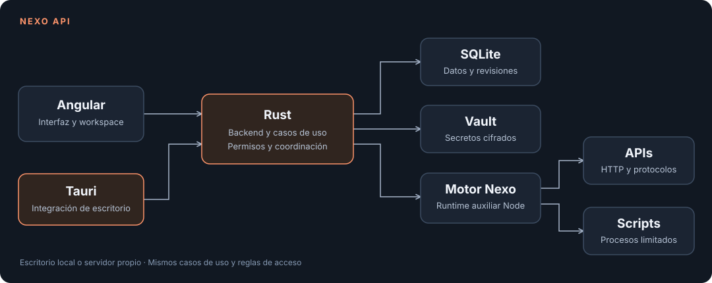

[](README.md)
[](README.es.md)

# Nexo API

**Your APIs. Your workspace. Your infrastructure.**

[](LICENSE)
[](https://github.com/DaftyCode/nexo_api/actions/workflows/desktop.yml)
[](https://github.com/DaftyCode/nexo_api/releases)

Nexo API is a **100% open source** application, licensed under MIT, for building, organizing, running and testing APIs on your computer.

We take inspiration from Postman and the convenience of keeping requests, collections, environments and tests in one place. From that inspiration, we are building an independent project with its own implementation and an architecture based on **Tauri + Rust + Angular**.

Our goal is a responsive tool that starts quickly, feels smooth and keeps you in control of your data. Rust runs the native backend, while Tauri integrates the operating system's WebView for the desktop interface. Requests, scripts, protocols, mocks and datasets also run in Rust, inside the same process; scripts run in an embedded QuickJS sandbox. Node is only needed to build the interface, never to run the app. We will publish reproducible startup, memory and latency benchmarks as the project develops.

The project is at an early stage. Contributions, ideas, testing and code reviews are welcome.

## What you can do

| Area                | Available features                                                                                                                                                                                                                                                                                                                                         |
| ------------------- | ---------------------------------------------------------------------------------------------------------------------------------------------------------------------------------------------------------------------------------------------------------------------------------------------------------------------------------------------------------- |
| Requests            | HTTP/HTTPS, methods, query and path parameters, headers and responses; raw, JSON and form bodies, multipart and binary file uploads, and GraphQL with an explorer and autocompletion.                                                                                                                                                                      |
| Organization        | Collections and folders, tabs, environments, variables, history and documents persisted in SQLite. Drag tabs, collections, folders, requests (also into another collection) and the sections of the menu; on start, everything keeps your order and tabs reopen with their unsaved changes.                                                                |
| HTTP authentication | Every type of Postman, Bruno and Insomnia: Basic, Bearer, API key, Digest, OAuth 1.0, OAuth 2.0 (all grants, PKCE, sign-in window in the desktop app like Postman's, tokens in the vault, auto-refresh and auto-fetch), AWS Signature v4, Hawk, NTLM, JWT Bearer, Atlassian ASAP, Akamai EdgeGrid, WSSE and Netrc; inherited from folders and collections. |
| Scripts and tests   | Pre-request and response scripts, scoped variables, `nx.test`, `nx.expect`, `nx.sendRequest`, logs and assertion results.                                                                                                                                                                                                                                  |
| Runner              | Collection iterations with JSON/CSV data, inherited scripts, progress, pause, cancellation, PDF reports and JSON/JUnit reports from the CLI.                                                                                                                                                                                                               |
| Protocols           | WebSocket, Socket.IO, MQTT, Kafka, gRPC (with a proto or through reflection) and GraphQL subscriptions over WebSocket or SSE.                                                                                                                                                                                                                              |
| MongoDB             | Connections, explorer, queries, document editing with safeguards, indexes, explain, profiler, stage-by-stage aggregations, schema, JSON/CSV import and export, change streams, shell, code generation, SQL and compare/sync.                                                                                                                               |
| Databases           | PostgreSQL, SQL Server, MySQL, MariaDB and SQLite in a DBeaver-style section: SQL editor, editable data grid, object sheets and structure, entity-relationship diagrams, sessions, locks and server dashboards. Each engine is a module downloaded when its first connection is created. Details in [Databases](#databases).                               |
| Import              | Portable JSON collections, environments, OpenAPI/Swagger JSON or YAML, HAR and cURL.                                                                                                                                                                                                                                                                       |
| Code                | Original generators for cURL, JavaScript/Node, Python, Java, Go, Rust, C# and PowerShell.                                                                                                                                                                                                                                                                  |
| Tools               | Local HTTP mocks, JSON/CSV datasets with read-only SQL queries, cookie manager, API definitions with a linter, Git with remotes and MCP client/server support.                                                                                                                                                                                             |
| Secrets             | AES-GCM encrypted vault, `{{vault:name}}` references, allowed domains per secret and secret redaction in results.                                                                                                                                                                                                                                          |
| Workspaces          | Several local workspaces, document history and revisions that prevent lost updates.                                                                                                                                                                                                                                                                        |
| Desktop and web     | Tauri desktop app, or the same interface in your browser through a local launcher when you cannot install the app.                                                                                                                                                                                                                                         |

Requests leave from your computer. Set `NEXO_EGRESS=deny-private` to refuse private and loopback destinations, except your own mocks; `NEXO_EGRESS_ALLOW` lists exceptions.

### Databases

- **Modules on demand:** Nexo installs as an API client. Each engine's driver is downloaded from GitHub Releases when the first connection of that type is created, checked against the SHA-256 the app carries and run as a separate process. The engine gallery shows each driver's icon, what it is, whether it is one of the most used and whether it is already installed.
- **Connections and navigator:** a wizard with a pasted URL (JDBC too), TLS, driver settings and connection type (production in red), and «Test connection». A keyboard-driven navigator with icons and counts, filters, a simple view, bookmarks and folders: a click expands a row and a double click opens the table on its data. Ctrl+H searches objects, data and saved scripts.
- **SQL editor:** each tab on its own session; the statement at the cursor, a selection or the script with DBeaver's keys, and confirmations before sending. It completes from the schema (an alias's columns, the join of a foreign key), formats, has templates, asks for `:name` parameters and sends them bound, generates a table's SQL and has a SQL console. A result tab per query (pin, run again, detach, read more, repeat; one per result of a procedure), messages with the line of an error, estimated or measured execution plans, saved scripts and history.
- **Manual transactions:** they count their statements, keep their log and are listed, with smart commit and a question before closing a tab with changes.
- **Data grid:** virtualized (100 000 rows and 200 columns), with striped rows, column and row menus, a status bar and rows read while scrolling. Keyboard, find, record view, copy as TSV, JSON, CSV, Markdown, `IN` or `INSERT`, Value, Metadata, Calc and Grouping panels, and formats in Settings. Rows are edited with their pending changes until they are all saved together.
- **Moving data:** export to eight formats, import CSV and JSON, and copy data between connections of different engines.
- **Objects and structure:** an object's sheet with its figures and views, properties in cards, sections, DDL and data filtered and ordered on the server, with foreign keys followed both ways. Tables are created and changed with forms or in their Columns view, with every type of the engine and its DDL shown before it runs. Views, routines and other objects start from a template of their engine.
- **Entity-relationship diagrams:** a table with its neighbours or every table of a schema, in IDEF1X, crow's foot or UML. They move with the mouse or the keyboard, are saved as your own diagrams with notes and export to SVG, PNG or PDF.
- **Administration:** session and lock managers (who is connected and who waits for whom; cancel a query or end a session after asking), users and roles with their memberships and privileges, and a dashboard per server that draws sessions, transactions, reads, size and locks every few seconds, with your own panels from read-only queries.
- **Working session:** tabs come back when reopened, without results. Closing, reloading or leaving the page closes the connections it opened, and the desktop app closes them on exit.

### Workspace layouts

The source includes four templates, selectable from **Template**: **Aurora** (the default: a white background, dark text and light code editors), **Aurora full color** (the same layout in night blue and violet), **Studio** (three columns with environment and request context), and **Canvas** (a light workspace with request and response side by side). They share the same collections, environments, variables, history and tools; both Aurora templates also share their panel sizes. Switching templates keeps the active request, turns the code editors light or dark at once and saves your preference on that device: the app always opens with the last template chosen. Canvas exposes the workspace navigation through **Tools** and **Browse collections**. Classic has been retired. Every HTTP method has its own colour in all layouts (GET green, POST yellow, PUT blue, PATCH purple, DELETE red); colours and sizes can be changed through [CSS variables](#styles-design-tokens).

### Interface languages

The source includes **English and Spanish**, with a language selector on the website, documentation and workspace. Transloco updates labels, menus, forms, accessibility text and known application messages immediately, without reloading. The preference is saved on that device; English is the default and fallback language. Layout and language preferences are independent. Request payloads, responses, scripts, variable values and names you give your resources remain unchanged.

Translations live in `src/app/infrastructure/i18n/en.json` and `es.json`. Simple message IDs use their English source text; interpolated messages use named keys. Add matching entries in both catalogs and run `npm run i18n:check` to check coverage and interpolation parameters. New languages also need registration in the language catalog, providers and selector. Server/engine diagnostics without a translation retain their original text.

## Download and install

Versions are published on [GitHub Releases](https://github.com/DaftyCode/nexo_api/releases). Check each release's assets: a platform configured in CI does not automatically mean an installer has been published for it.

| Operating system | Architecture                              | Packages configured in CI                           |
| ---------------- | ----------------------------------------- | --------------------------------------------------- |
| Windows          | x64                                       | NSIS `.exe` installer and Windows Installer `.msi`. |
| macOS            | Apple Silicon and Intel, built separately | `.app` application inside a `.dmg`.                 |
| Linux            | x64                                       | `.deb`, `.rpm` and `.AppImage`.                     |

Each build runs on a runner for its operating system. Installers are self-contained: end users do not need to install Node or Rust. Each release also publishes the database drivers, which the app downloads by itself when they are needed, and a `SHA256SUMS` file to check the downloads.

### Microsoft Store

[](https://apps.microsoft.com/detail/9N6H77VSRDQ4?mode=direct)

Nexo API is in the Microsoft Store: the Store signs the package, installs it and keeps the app updated. On Windows, the button opens the listing directly in the Store app. To build the MSIX package locally, run `npm run desktop:msix` (it needs the Windows SDK).

## How it works



Nexo runs for one person on one computer. The desktop application starts a Rust service on a random loopback port and authenticates with a per-run token. The web version uses the same service: its launcher listens only on loopback and opens the browser with a one-time link that becomes an HttpOnly session cookie. Requests need a loopback Host header, an allowed Origin and the Nexo client header, so other websites and computers cannot use the service. Data stays in the app data directory; secrets are encrypted with a key kept in the operating system's credential store.

Each database has its driver in a separate process. Its SHA-256 is checked when it is installed and again before every start. The driver receives passwords only on its standard input and asks the service for every network destination, so its connections also go through the egress policy.

## Architecture we want to preserve

### Backend: hexagonal architecture

```text
backend/crates/
  nexo-domain/          Domain entities, rules and errors
  nexo-application/     Use cases and ports
  nexo-infrastructure/  SQLite, Git and credential store adapters
  nexo-engine/          Execution adapter: HTTP, QuickJS scripts, protocols, mocks, datasets, vault
  nexo-mongo/           MongoDB adapter
  nexo-modules/         Installs the database modules, starts each driver and talks to it
  nexo-driver-sdk/      What a driver and the app share: protocol, typed values and the driver runtime
  nexo-http/            HTTP adapter
  nexo-server/          Composition root and CLI
backend/drivers/       One executable per engine (PostgreSQL, SQL Server, MySQL and MariaDB, SQLite), depending only on the SDK
src-tauri/             Desktop composition root
```

The domain has no knowledge of HTTP, databases or graphical interfaces. Use cases depend on contracts; adapters implement those contracts. Tauri and the server compose the same capabilities. Drivers are never dependencies of the app and are not part of its installers.

### Frontend: Clean Architecture

```text
src/app/
  domain/          Angular-independent models and rules
  application/     Use cases and contracts
  infrastructure/  Contract implementations
  presentation/    Angular components, state and views
  composition/     Dependency injection and configuration
```

Presentation calls use cases. HTTP and file handling stay in infrastructure. We use standalone components, signals, OnPush, Signal Forms and lazy routes.

We follow **SOLID and Clean Code**: clear module responsibilities, small ports, inward dependencies, interchangeable implementations, concrete names and focused functions. Abstractions should solve a real need. `npm run test:architecture` checks layer boundaries.

### Styles: design tokens

Every colour and size in the interface is a `--nexo-*` CSS variable. Style rules only read variables; the values live in one place:

- **Global tokens** (`src/styles/tokens/`): the typography, spacing, size, corner, border, shadow, motion and stacking scales; the semantic palette (backgrounds, surfaces, borders, text, accent, states, code); one token per workspace area (top bar, navigation, tabs, URL bar, panels) and the HTTP method colours.
- **Theme tokens** (each template's `_theme.scss`): Aurora, Studio and Canvas only redefine values; they do not repeat rules.

They sit in the `nexo-tokens` CSS layer, so any external stylesheet overrides them without `!important`:

```css
.studio {
  --nexo-color-accent: #2f81f7;
  --nexo-space-unit: 2.5px; /* a looser interface */
}
```

We want changing a theme to mean changing variables, and anyone to be able to make their own. Loading custom themes from the app is the next step. `npm run test:architecture` rejects literal colours or sizes outside the token files. The full guide is in [src/styles/README.md](src/styles/README.md).

## Build the desktop app from a clean checkout

Build on the operating system and CPU architecture you want to distribute: the scripts install the pinned Node and Rust toolchains, build the interface and the desktop app, and leave the installers under `target/release/bundle`. [docs/BUILD.md](docs/BUILD.md) explains the one-step install, the build options, manual builds, the local web version and the CLI.

## Current status and next steps

The current version is **0.9.0**, with PostgreSQL, SQL Server, MySQL, MariaDB and SQLite in the «Databases» section and the complete MongoDB client. Tests cover real requests, variables, scripts, assertions, cancellation, cookies, secret redaction, OpenAPI imports, executable generated code, data-driven runs, every authorization type (with official vectors and verifying servers), unary and streaming gRPC with a proto or reflection, WebSocket, Socket.IO, MQTT, Kafka, GraphQL subscriptions, real MongoDB and FerretDB, real PostgreSQL, SQL Server, MySQL and MariaDB servers and SQLite files, egress policy, local access control and revisions. Contract tests in `tests/contract` drive the real server binary. The interface's unit tests cover at least 90% of its statements, branches, functions and lines (`npm run test:coverage`, which CI runs): every change comes with its tests. It is built with Rust 1.100, Angular 22.2 and Tauri 2.12, with every dependency at the latest version they accept. The audit of the production dependencies in CI (`npm run audit:check`) accepts only the exceptions of `tools/audit-exceptions.json`, each with a reason and an expiry date: today one, picomatch, used only by the build tools and with no fixed release yet, until 2026-12-17.

Current limits include 5 seconds and 128 MB of memory per script evaluation, eight active runs and response size limits for the interface. Cookies are kept per workspace in the data directory. MQTT 5, Socket.IO 2.x (Engine.IO v3) and Kafka consumer groups, transactions and Schema Registry are not supported yet. External OpenAPI `$ref` references must be bundled before import. Unknown authorization types are rejected explicitly. Protocol and format support will grow alongside reproducible test cases.

### Next steps

In the planned order:

1. **API client improvements** (next, to finish that part): SSH tunnels and SOCKS5 proxies, protected environments (colour, confirmation and read-only), scheduled runs, comparing responses between runs or environments, Excel or CSV export with masked data, inferring the JSON Schema of responses, and imports from Insomnia, Bruno, Hoppscotch and Thunder Client.
2. **More databases:**
   - Backup and restore with each engine's native client.
   - Comparing and syncing data and schemas.
   - Advanced connections: SSH tunnels, network settings, connection startup and importing connections from other tools.
   - A visual query builder, a test data generator, result charts and a spatial data viewer.
   - Files as a database (CSV, JSON, Parquet and Excel).
   - Saved, composite and scheduled database tasks.
   - SQL from request scripts (`nx.sql`), read-only MCP tools and a query's code in several languages.
   - New engines: Cassandra and ScyllaDB, Redis and Valkey, Elasticsearch and OpenSearch, and Apache Drill. Oracle waits for a stable release of its Rust driver; DB2, Apache Hive and Apache Ignite are being evaluated.
   - MongoDB will become one more downloadable module, in the same tree as the rest.
3. **An AI assistant** using each user's own API key.
4. **Development tooling without Node outside Angular:** contract tests and build scripts in Rust.
5. **Custom themes** from the app, built on the design tokens.
6. **Distribution:** WinGet, Homebrew, signed APT/YUM repositories and Flatpak. Signing the installers and drivers outside the Store on Windows, macOS notarization and validating the installers on clean machines.
7. **Reproducible benchmarks** of startup, memory and latency.

This section is updated with every change, always in both READMEs (`README.md` and `README.es.md`) at once:

- What is finished leaves «Next steps» and moves to [What you can do](#what-you-can-do) or to the current status.
- Every new task enters «Next steps», in its place in the planned order.
- What is dropped is removed from the list.

## Contributing

You can open an [issue](https://github.com/DaftyCode/nexo_api/issues), propose an improvement, fix a bug, expand tests or submit a pull request. You do not need permission to get started. For larger changes, an issue describing the problem and proposal helps coordinate the work.

1. Fork the repository and create a focused branch, such as `feat/http-history` or `fix/runner-cancel`.
2. Keep each change focused on one problem and respect layer boundaries and responsibilities.
3. Add behavior tests when changing rules or adapters. Include a reproduction test when fixing a bug.
4. Run the relevant checks and explain the problem, resulting behavior and validation in your PR.
5. If your change finishes or adds something, update [Current status and next steps](#current-status-and-next-steps) in both READMEs.
6. Preserve dependency notices and licenses. Keep local data, credentials and generated artifacts out of Git.

### Commits

We use Conventional Commits with a short subject and a scope where useful:

```text
feat(runner): support data-driven iterations
fix(vault): redact secrets from execution logs
refactor(domain): separate request validation
test(http): cover cross-origin redirects
docs(readme): explain the local web version
chore(packages): update installer manifests
```

Each commit should have one clear purpose. Explain the motivation in the body when it is not obvious from the change. Use `!` and `BREAKING CHANGE:` for incompatible contract changes. PRs should preserve backend hexagonal architecture, frontend Clean Architecture and SOLID principles.

## License

Nexo API is distributed under [MIT](LICENSE): you can use, study, modify, redistribute and contribute to it, including in commercial environments. Dependencies retain their own licenses.
